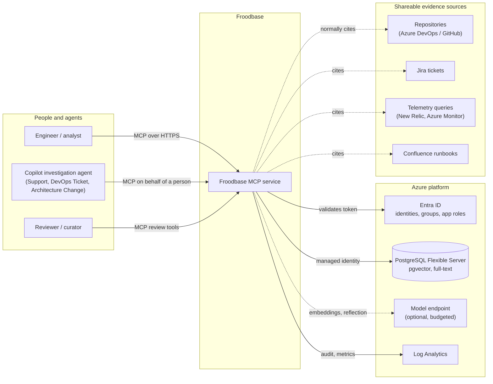
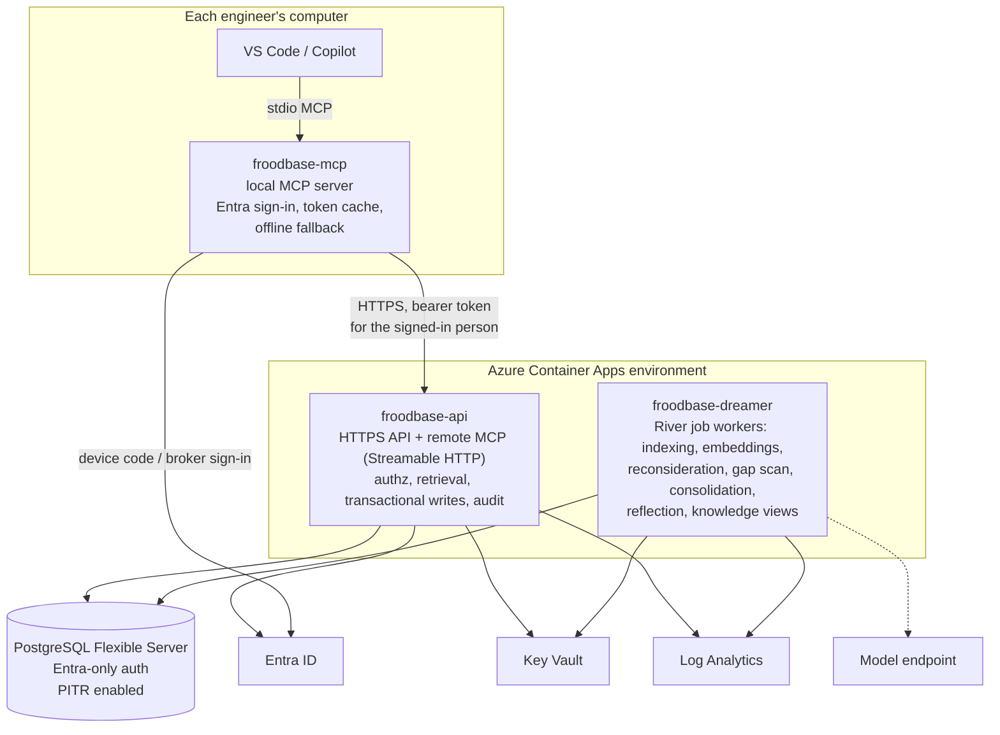
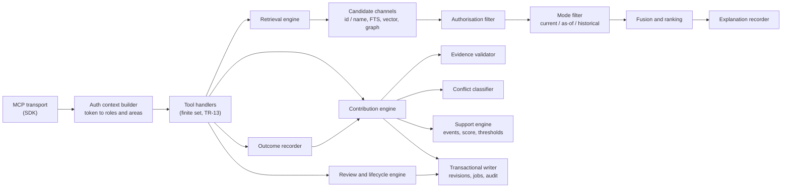
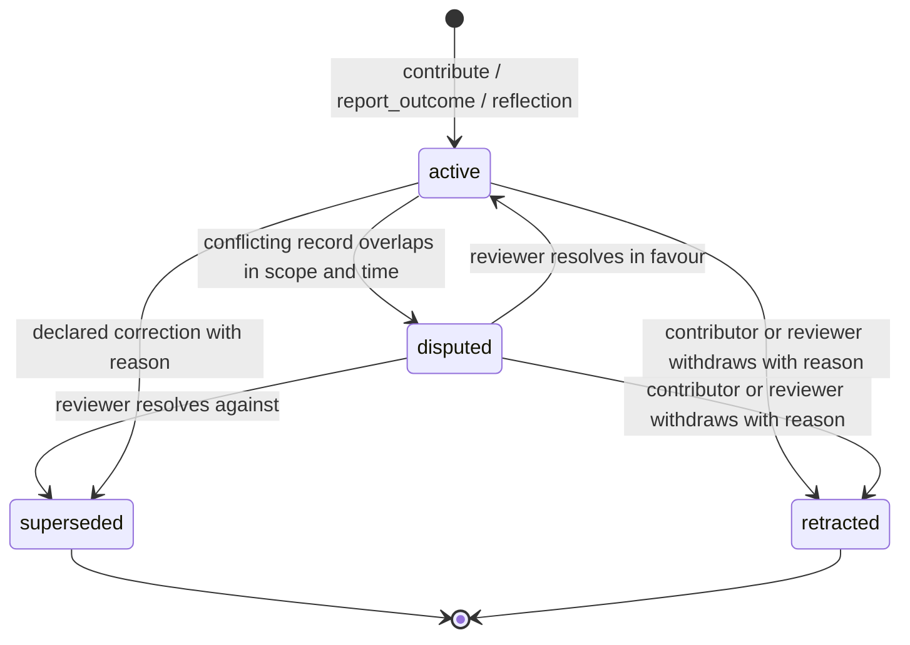
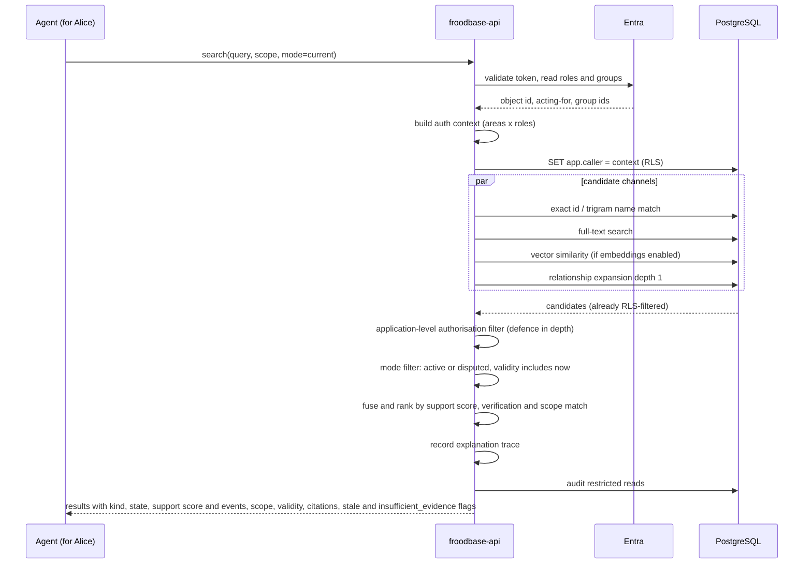
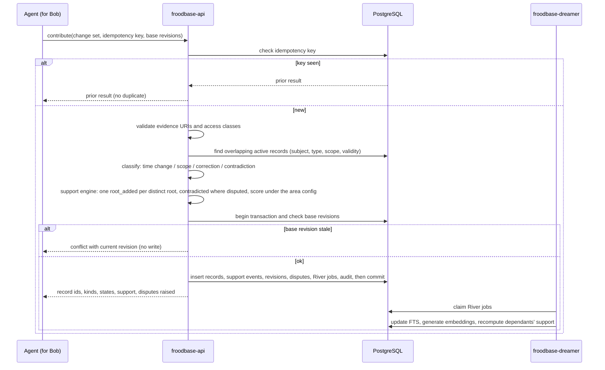
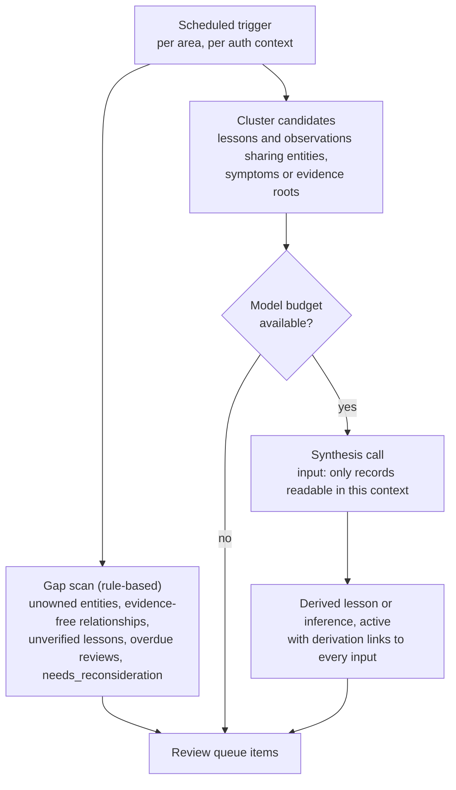
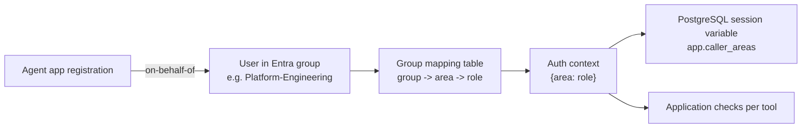
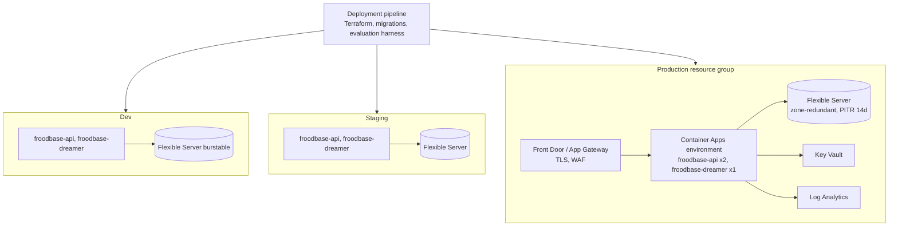

# Froodbase: architecture design

Status: draft for architecture review. Satisfies the [technical requirements](02-technical-requirements.md) (`TR-nn`). Decisions are recorded in section 11 so they can be challenged individually. Section 15 records what was adapted from Graphiti and Hindsight, with the detail in the [reuse research](06-reuse-research-graphiti-hindsight.md). The incremental OpenBrain assessment is in [its own research note](08-reuse-research-openbrain.md).

Date: 13 October 2026. Revised 14 October 2026 for Go, the three binaries, Graphiti and Hindsight; revised 16 October 2026 for living-source extraction, continuous review and OpenBrain findings, and again the same day to replace approval states with earned support and to remove report ingestion.

## 1. Design principles

1. **Canonical records are relational and append-only.** Full-text indexes, embeddings and generated Markdown are projections that can be rebuilt from them.
2. **Authorisation before everything.** Candidates are filtered by the caller's permissions before ranking, snippets, fusion or any model sees them.
3. **Two clocks.** Every fact separates when it was true (validity time) from when we recorded it (transaction time). Neither is inferred from the other.
4. **Evidence has roots.** Derivation links let the service count distinct evidence, not repeated restatements.
5. **Support is earned, never granted.** Every claim is active from the moment it is written and carries a support score built only from distinct evidence roots, verification checks and evidenced use outcomes. Fluent text, repeated restatements, model confidence and retrieval earn nothing. There is no approval state; every step remains inspectable and correctable.
6. **Small surface.** A finite MCP tool set, one database, one Go module. Anything larger must earn its place in the pilot.
7. **One module, three binaries.** A local MCP binary on each computer, a remote API, and a background "dreamer" share the same Go packages for the domain rules, so there is one definition of validity, scope overlap and authorisation.
8. **Adapt designs, not runtimes.** Graphiti and Hindsight contribute proven shapes (bitemporal edges, episodes as provenance, deterministic entity resolution, hybrid recall, citation-validated synthesis). Their write-path automation is deliberately not reproduced.
9. **Extract from living sources; never store documents.** Repositories, Confluence pages, reports and other documents remain where they are. Froodbase stores evidenced records, versioned source references and at most a short excerpt per piece of evidence. Reports, conversations and transcripts are never an input.
10. **Human oversight is correction, not approval.** Reviewers can inspect the full contribution history, flag, retract, supersede and resolve disputes. Nothing waits for them.

## 2. System context



Froodbase stores claims and evidence *references*. It does not mirror repositories, Confluence pages, tickets or telemetry. A source reference names a stable location and revision where available, with a precise locator or short excerpt so a reviewer can check what supported extraction. If a source changes or disappears, its historical claim remains; detected loss or change of support lowers the claim's support and is a review signal, not an inferred change to validity. Local investigation reports, conversations and transcripts are outside the boundary and never cross it: agents contribute individual evidenced claims as they work, and the report lists what was contributed.

## 3. Binaries and containers

One Go module, three binaries under `cmd/`, sharing `internal/` packages for the domain model, authorisation context, retrieval and storage.



| Binary | Runs | Responsibility | Scaling |
|---|---|---|---|
| `froodbase-mcp` | On each computer, launched by the IDE over stdio | Exposes the finite tool set to the local agent; signs the person in with Entra and caches the token; forwards tool calls to `froodbase-api`; never reads local documents; returns a clear "Froodbase unavailable" result so the agent can fall back to packaged and local knowledge | One process per IDE session |
| `froodbase-api` | Azure Container Apps | Validates tokens, builds the authorisation context, serves the same tools over Streamable HTTP for clients that can do remote MCP, runs synchronous retrieval and transactional writes, writes audit events, enqueues jobs | Stateless, 2 or more replicas |
| `froodbase-dreamer` | Azure Container Apps | Consumes the job queue: full-text and trigram maintenance, embedding generation, support recomputation for dependants, use-without-challenge credits, review-date sweeps, rule-based gap scans, consolidation and reflection, knowledge-view refresh | 1 replica per queue partition; singleton locks per periodic job |
| PostgreSQL | Flexible Server | Canonical records, revisions, projections, job queue, audit | Zone-redundant in production |

Why a local binary rather than remote MCP only:

- VS Code and Copilot launch stdio MCP servers without any OAuth configuration in the client; the remote OAuth flow in MCP clients is still uneven, and the Go SDK marks its client-side OAuth as experimental.
- Token handling is in one place. `froodbase-mcp` acquires a token for the person with the device-code or broker flow and refreshes it; agents never see credentials.
- The fallback is local. If `froodbase-api` is unreachable, `froodbase-mcp` answers with an explicit unavailable result rather than a transport error.

The cost is distribution: a per-machine binary needs a release and update path. The toolkit's existing install scripts carry it, and `froodbase-mcp` reports its version to `froodbase-api` so an outdated client can be told to update.

Both server binaries use the same managed identity to reach PostgreSQL. The caller's identity is passed into every transaction as a session variable for row-level security (TR-71).

### 3.1 Go technology stack

| Concern | Choice | Notes |
|---|---|---|
| Language | Go, current stable release | Single module, `cmd/froodbase-mcp`, `cmd/froodbase-api`, `cmd/froodbase-dreamer`, shared `internal/` packages |
| MCP | [modelcontextprotocol/go-sdk](https://github.com/modelcontextprotocol/go-sdk) (v1.8.0, Apache-2.0 for new code, MIT for existing) | `StdioTransport` for `froodbase-mcp`; `NewStreamableHTTPHandler` for `froodbase-api`; `auth.RequireBearerToken` with a `TokenVerifier` for Entra tokens; `ProtectedResourceMetadataHandler` for RFC 9728 discovery |
| Entra | [azidentity](https://pkg.go.dev/github.com/Azure/azure-sdk-for-go/sdk/azidentity) (v1.14.1) | `ManagedIdentityCredential` for the servers; device-code or broker credential in `froodbase-mcp`; `OnBehalfOfCredential` available if an agent identity must exchange a user assertion |
| Token validation | [coreos/go-oidc v3](https://github.com/coreos/go-oidc) (Apache-2.0) or `lestrrat-go/jwx` | Verify signature against the tenant JWKS, issuer, audience and expiry; read roles and group claims |
| Database access | [pgx v5](https://github.com/jackc/pgx) with `sqlc` for typed queries | Session variable set per transaction for RLS; `tstzrange` and JSONB scope handled natively |
| Vectors | [pgvector-go](https://github.com/pgvector/pgvector-go) (v0.4.0, MIT) | pgx integration; HNSW index with `vector_cosine_ops`; optional per area |
| Job queue | [River](https://github.com/riverqueue/river) (MPL-2.0) with `riverpgxv5` | Transactional insertion in the same transaction as the record write (the outbox pattern, D5); periodic jobs for sweeps; unique jobs for per-record reconsideration; retries with backoff |
| Migrations | `tern` or `goose`, run from the pipeline | Forward-only, versioned (TR-92) |
| Fusion and ranking | Plain Go | Reciprocal rank fusion with k of 60 is a few lines; no library needed |
| Telemetry | OpenTelemetry Go SDK to Log Analytics | Per-tool latency, queue depth, index staleness (TR-93) |
| Infrastructure | Terraform | Existing module conventions (TR-04) |

Nothing is copied from Graphiti or Hindsight; both are Python and neither offers a Go library. Designs adapted from them are listed in section 15.

## 4. Components inside froodbase-api



Component responsibilities:

- **Auth context builder.** Validates the Entra token, resolves app roles and group claims to a set of (area, role) pairs, and captures the acting-for identity for agents. The context is immutable for the request and is the only input the authorisation filter and RLS session variable use.
- **Retrieval engine.** Orchestrates the four channels, then filter, then mode, then ranking. Records every candidate decision so `explain_answer` can replay it (TR-55).
- **Contribution engine.** Validates evidence (TR-61), resolves entities through deterministic tiers and raises merge proposals for anything fuzzier, classifies conflicts (TR-41), asks the support engine for each record's initial events and score, and writes the change set atomically with revisions, River jobs and audit events. The conflict classifier is a detector only: the interval-overlap test adapted from Graphiti and, where a model is used, Graphiti's conservative contradiction rules produce a dispute record. Nothing ever writes `valid_to` on an existing record except a reviewer's supersession with a stated end date.
- **Review and lifecycle engine.** Dispute resolution, supersession, retraction, verification and flags, with role checks, base-revision checks and rationale capture (TR-40, TR-45).
- **Outcome recorder.** `report_outcome` (TR-59): turns an evidenced success into an observation with its own root linked to the record it tested, routes an evidenced failure through the conflict classifier, and keeps inapplicable and not-used reports for evaluation only.
- **Contribution oversight.** Area-scoped queries join each contribution to its individual claims, revisions, source references, support events, flags and decisions. A reviewer can flag one claim with a reason; its state remains until a later authorised decision. Operational audit events retain who did what, while the contribution and revision records retain what knowledge was entered and how its support changed (TR-45, TR-75).
- **Support engine.** Owns the support-event vocabulary (TR-29) and the area support configuration (TR-43). Appends events when roots are linked, verifications recorded, outcomes reported, sources change, claims are contradicted, flagged or lose a supporting record; projects the score; compares it with the area threshold per kind so retrieval can set `insufficient_evidence`. It never changes a claim's kind or lifecycle state and never infers a date.

## 5. Data model

```mermaid
erDiagram
    KNOWLEDGE_AREA ||--o{ ENTITY : contains
    KNOWLEDGE_AREA ||--o{ ASSERTION : contains
    KNOWLEDGE_AREA ||--o{ LESSON : contains
    KNOWLEDGE_AREA ||--o{ SUPPORT_EVENT : contains
    KNOWLEDGE_AREA ||--o{ SUPPORT_CONFIG : configures
    KNOWLEDGE_AREA ||--o{ GROUP_MAPPING : grants

    ENTITY ||--o{ ENTITY_NAME : "named by"
    ENTITY ||--o{ RELATIONSHIP : "source of"
    ENTITY ||--o{ RELATIONSHIP : "target of"
    ENTITY ||--o{ ASSERTION : "subject of"
    ENTITY ||--o{ LESSON : "applies to"

    RELATIONSHIP ||--o{ CLAIM_EVIDENCE : "supported by"
    ASSERTION ||--o{ CLAIM_EVIDENCE : "supported by"
    LESSON ||--o{ CLAIM_EVIDENCE : "supported by"
    EVIDENCE ||--o{ CLAIM_EVIDENCE : supports

    ASSERTION ||--o{ REVISION : "versioned by"
    RELATIONSHIP ||--o{ REVISION : "versioned by"
    LESSON ||--o{ REVISION : "versioned by"
    ENTITY ||--o{ REVISION : "versioned by"

    ASSERTION ||--o{ DERIVATION : "derived from"
    LESSON ||--o{ DERIVATION : "derived from"
    ASSERTION ||--o{ SUPERSESSION : "replaced by"
    RELATIONSHIP ||--o{ SUPERSESSION : "replaced by"
    ASSERTION ||--o{ DISPUTE : "party to"
    RELATIONSHIP ||--o{ DISPUTE : "party to"
    ASSERTION ||--o{ SUPPORT_EVENT : "supported by"
    RELATIONSHIP ||--o{ SUPPORT_EVENT : "supported by"
    LESSON ||--o{ SUPPORT_EVENT : "supported by"
    ASSERTION ||--o{ OUTCOME : "tested by"
    LESSON ||--o{ OUTCOME : "tested by"

    REVISION ||--|| AUDIT_EVENT : "recorded as"
    REVISION ||--o{ RIVER_JOB : "schedules"
    CONTRIBUTION ||--o{ CONTRIBUTION_CLAIM : asserts
    ASSERTION ||--o{ CONTRIBUTION_CLAIM : "asserted by"
    RELATIONSHIP ||--o{ CONTRIBUTION_CLAIM : "asserted by"
    ENTITY ||--o{ ENTITY_ALIAS : "known as"
    RELATIONSHIP_TYPE ||--o{ RELATIONSHIP : types

    ENTITY {
        uuid id PK
        text entity_type
        uuid area_id FK
        text lifecycle_state
        int revision
    }
    ENTITY_NAME {
        uuid entity_id FK
        text name
        jsonb scope
        timestamptz valid_from
        timestamptz valid_to
    }
    RELATIONSHIP {
        uuid id PK
        uuid source_entity_id FK
        uuid target_entity_id FK
        text rel_type
        jsonb scope
        timestamptz valid_from
        timestamptz valid_to
        timestamptz recorded_at
        timestamptz verified_at
        timestamptz review_due_at
        text lifecycle_state
        int revision
    }
    ASSERTION {
        uuid id PK
        uuid subject_entity_id FK
        text epistemic_kind
        text body_markdown
        tsvector body_fts
        vector body_embedding
        jsonb scope
        timestamptz valid_from
        timestamptz valid_to
        timestamptz recorded_at
        timestamptz verified_at
        timestamptz review_due_at
        text lifecycle_state
        numeric support_score
        bool needs_reconsideration
        int revision
    }
    LESSON {
        uuid id PK
        text symptoms_md
        text conditions_md
        text failed_approaches_md
        text remedies_md
        text applicability_md
        jsonb scope
        text lifecycle_state
        int revision
    }
    EVIDENCE {
        uuid id PK
        text source_kind
        text source_uri
        text source_revision
        text source_locator
        text excerpt
        text access_class
        uuid root_evidence_id
        text importer_name
        text importer_version
        text extraction_version
        text content_fingerprint
        text input_digest
        text original_author
        text attribution_status
        timestamptz observed_at
        timestamptz recorded_at
    }
    SUPPORT_EVENT {
        uuid id PK
        uuid record_id
        uuid area_id FK
        text event_type
        jsonb evidence_root_ids
        jsonb scope
        uuid actor_user_id
        uuid actor_agent_id
        text job_name
        text config_version
        text rationale
        timestamptz at
    }
    SUPPORT_CONFIG {
        uuid area_id FK
        text version
        jsonb event_weights
        numeric use_without_challenge_cap
        jsonb threshold_by_kind
        jsonb allowed_contributors
    }
    OUTCOME {
        uuid id PK
        uuid record_id
        int record_revision
        uuid request_id
        text outcome
        jsonb scope
        uuid observation_id
        text reason
    }
    REVISION {
        uuid record_id
        int revision
        jsonb snapshot
        uuid actor_user_id
        uuid actor_agent_id
        text rationale
        timestamptz recorded_at
    }
    DISPUTE {
        uuid id PK
        uuid record_a
        uuid record_b
        text status
        text resolution_md
    }
    RIVER_JOB {
        bigint id PK
        text kind
        jsonb args
        text state
        int attempt
    }
    CONTRIBUTION {
        uuid id PK
        uuid actor_user_id
        uuid actor_agent_id
        text client
        text investigation_ref
        timestamptz recorded_at
    }
    ENTITY_ALIAS {
        uuid entity_id FK
        text name
        uuid merged_from_entity_id
        text rationale
        timestamptz recorded_at
    }
    RELATIONSHIP_TYPE {
        text rel_type PK
        text source_entity_type
        text target_entity_type
        text cardinality
    }
    AUDIT_EVENT {
        uuid id PK
        text event_type
        uuid actor_user_id
        uuid actor_agent_id
        jsonb detail
        timestamptz at
    }
```



Notes on the model:

- **Scope** is a JSONB object with fixed keys (`environment`, `region`, `version_min`, `version_max`, `cluster`, `tenant`). A missing key means unspecified. Overlap is computed by a SQL function so the conflict classifier and the mode filter use the same definition (TR-26).
- **Evidence roots.** `root_evidence_id` points at the original observation when an evidence record is itself a restatement (for example a report excerpt quoting a telemetry query). Corroboration counts distinct roots (TR-25).
- **Three independent axes.** Epistemic kind (`observation`, `decision`, `inference`) says what a statement is and never changes; `support_score` says how well evidence and experience back it; lifecycle says whether it is active, disputed, superseded or retracted. The score is a projection of the append-only `support_event` rows under the area's `support_config` version, so it can be recomputed and explained. A well-supported inference stays an inference. Updating support never guesses a validity date or erases an earlier event (TR-29).
- **Living-source extraction.** A repository commit and path, Confluence page ID and version, or equivalent stable source reference identifies the material examined. `source_locator` can name a line range or section; a short excerpt may preserve the basis for a historical claim when the live source changes. Importer and extractor identity/version and optional input digest belong to contribution or evidence provenance. A content fingerprint suggests duplicate claims but never merges independent evidence roots. Original-author attribution is separate from the authenticated contributor and may remain unknown (TR-24, TR-65). No document body is ever stored.
- **Revisions** hold a full JSONB snapshot of the record at each change. This makes `get_history` and `get_as_of` by recording time trivial, and keeps the live tables narrow.
- **Validity-time queries** use a GiST index on `tstzrange(valid_from, valid_to)` combined with lifecycle state (TR-34).
- **Full-text** uses a generated `tsvector` column with an English configuration plus a trigram index on entity names for near-miss matching (TR-51).
- **Embeddings** are nullable; the row is committed before the dreamer fills them (TR-58).
- **Contribution as episode.** Each `contribute` call is a `contribution` record (who, acting agent, client, investigation id, recorded time) and a `contribution_claims` join lists every record it asserted or re-asserted. This is Graphiti's episode-to-edge provenance, with the contribution's recording time kept separate from any validity date.
- **Queryable knowledge history.** The contribution, claim, support-event and revision records remain available to authorised area reviewers independently of the 400-day operational audit-event retention. Filtered, paginated reads include active, disputed, superseded and retracted claims. Review flags and their reasons are appended to history and enter the due-for-review queue without altering the claim's validity or state. Per-area authorisation applies before counts, joins and source excerpts (TR-45, TR-75).
- **Entity aliases and reversible merges.** `entity_alias` holds every name an entity has carried and, after a merge, which entity id was folded into which with the curator's rationale. A merge never rewrites claims; it records an alias, so it can be undone. Neither Graphiti nor Hindsight can un-merge.
- **Relationship types with cardinality.** `relationship_type` holds the allowed (source type, target type) pairs and whether the predicate is single-valued (one owner) or multi-valued (many dependencies). Cardinality is what lets the conflict classifier tell "replaced" from "added"; its absence is the root of Graphiti's mis-retirement issue.
- **Causal links.** A `caused_by` link between assertions is an inference, not a direct observation. It starts with the support of its roots, earns more when a remedy built on it succeeds with evidence, and remains labelled inferred at every level. It is the one Hindsight link type adopted; semantic links are a rebuildable projection and are deferred.

## 6. Temporal and lifecycle semantics



Validity is orthogonal to lifecycle. An active record whose `valid_to` has passed is correct history, not an error. The `current` mode therefore asks two questions of each record: is it active or disputed, and does its validity range include now (or is `valid_to` null). Records passing both but with stale `verified_at` are returned with a `stale: true` flag rather than excluded (TR-31); disputed records are returned labelled disputed.

Support is orthogonal too, and it is where a claim's certainty lives. Every record enters active with a score projected from its initial events: one `root_added` per distinct evidence root. It rises with further roots, with `verified` events (a person or agent re-checked it against fresh evidence on a date, in a scope), with `outcome_succeeded` events (someone applied it and reports with evidence that it worked), and, by a bounded amount, with `use_without_challenge` credits the dreamer appends while the record is being used and nothing contradicts it. It falls with `outcome_failed`, `contradicted`, `source_changed`, `flagged` and `support_retracted`. Retrieval appends nothing. The area's `support_config` gives each event type a weight within service bounds, caps the use credit below the inference threshold, and sets the threshold per kind under which answers carry `insufficient_evidence`. Nothing in this machinery changes a claim's kind, resolves a dispute or infers a date (TR-29, TR-43, TR-44).

Worked example from the pitch, as stored:

| Record | Kind | Scope | valid_from | valid_to | recorded_at | State and support |
|---|---|---|---|---|---|---|
| Callback failure reproduced | observation | prod, v2.3 | 2026-09-02 | null | 2026-09-02 | active; two roots, verified 2 Sep |
| Fix merged (PR 418) | observation | repo main | 2026-09-05 | null | 2026-09-05 | active; one root |
| v2.4 deployed, remediation verified | observation | prod, v2.4 | 2026-09-09 | null | 2026-09-09 | active; supersedes the failure record with reason "remediated in 2.4" |
| Older investigation imported | evidence + inference | prod, v2.3 | 2026-09-02 | 2026-09-09 | 2026-10-13 | active, historical by validity; as-of 2026-09-03 query returns it, current does not |

The merge record does not supersede the failure record because its scope (repository) does not overlap production. Only the verified deployment does.

## 7. Request flows

### 7.1 Current-state retrieval



### 7.2 Contribution with conflict classification



### 7.3 Correction and propagation

A contributor or reviewer calls `review_claim(supersede, old_id, new_id, reason, base_revision)`. The lifecycle engine writes a supersession link and new revisions for both records in one transaction, then enqueues a `reconsider_derived` job. The dreamer walks derivation links from the old record, appends `support_retracted` to every dependent inference and lesson, recomputes their scores and sets `needs_reconsideration` on those that fell below threshold. Those appear in `list_due_for_review` for the area's reviewers. `current` search excludes the superseded record immediately because mode filtering reads lifecycle state from the canonical table, not from a projection (TR-94). Retraction follows the same path.

### 7.4 Contributing during an investigation, and reporting an outcome

```mermaid
sequenceDiagram
    participant U as User
    participant Ag as Investigation agent
    participant MCP as froodbase-mcp (local)
    participant API as froodbase-api

    Ag->>MCP: search(symptom, scope, mode=historical)
    MCP->>API: search
    API-->>Ag: lesson L (inference, support 0.4, applicability "staging only")
    Ag->>Ag: applies the remedy from L in prod EU, checks telemetry afterwards
    Ag->>MCP: contribute(observation "restarts stopped after remedy", telemetry query cited)
    MCP->>API: contribute
    API-->>Ag: observation O1 (active, one root)
    Ag->>MCP: report_outcome(L, revision, succeeded, scope prod EU, evidence O1)
    MCP->>API: report_outcome
    API->>API: link O1's root to L, append outcome_succeeded in scope prod EU, recompute L's score
    API-->>Ag: L now support 0.7, applicability extended to prod EU (verified 9 Sep)
    Ag-->>U: local report lists O1 and the outcome on L; nothing from the report was sent
```

The agent contributes what it can evidence, one finding at a time, while the investigation runs. Each contribution is a small change set with its own shareable citations; the conversation and the report never leave the machine, and `froodbase-mcp` never reads them. The local report lists the identifiers written, so the person can inspect or retract any of them afterwards. Importing an old report works the same way: a skill reads the file locally, extracts the findings it can cite, and calls `contribute`; the file is not sent and nothing of it is retained. An outcome report is how experience becomes certainty: a success with evidence is a new observation and a new root for the record it tested; a failure with evidence lowers it and, if it contradicts the record, raises a dispute.

## 8. Retrieval design in detail

| Stage | Mechanism | Why |
|---|---|---|
| Identifier channel | Exact match on record id, entity id, ticket key or repository path; identity keys and aliases; trigram similarity on entity names above a threshold | Investigations usually start from a known name; near-miss names must not silently merge environments, so similarity returns candidates for the caller to confirm, never auto-resolves. The same deterministic tiers (identity key, exact name, trigram) are used by the contribution engine's entity resolver, adapted from Graphiti's cascade and Hindsight's trigram scoring |
| Full-text channel | `websearch_to_tsquery` over `body_fts` with `ts_rank_cd` | Cheap, deterministic, no model dependency |
| Vector channel | `pgvector` cosine distance with an HNSW index, enabled per area | Finds analogous incidents phrased differently; optional until the corpus shows need |
| Graph channel | Relationship expansion from matched entities to depth 1 (configurable to 2), filtered by relationship validity in the requested mode; candidates scored by shared entities with the query's entities | Answers "what depends on X" without text matching. Hindsight's single-hop arm scored by shared entities is the model; a recursive CTE bounds depth |
| Authorisation filter | RLS plus application check on `area_id` and `access_class` | Defence in depth; RLS alone can be bypassed by privileged roles |
| Mode filter | SQL predicate over lifecycle state and validity range | Current, as-of and historical semantics live in one function used by every channel |
| Fusion | Reciprocal rank fusion across channels (k of 60, as both reference projects use), then boosts for support score, verification recency and scope match; no recency boost in current mode; no mention-count boost | Prevents "newer text wins". Graphiti's episode-mentions reranker and Hindsight's `proof_count` boost both reward restatement, so they are deliberately not reproduced; support counts roots and outcomes, not mentions |
| Explanation | Per-authorised-candidate record of channel hits, mode-filter outcomes and final rank, stored for the request id | Supports `explain_answer` and the evaluation harness without revealing inaccessible candidate identities or counts |
| Outcome reports | `report_outcome` links the request and exact returned revision to succeeded, failed, inapplicable or not-used, with scope, caller and, for succeeded and failed, evidence of what was observed | An evidenced success is a new observation and root for the record; an evidenced failure lowers it or disputes it; inapplicable and not-used inform evaluation only; a bare claim of success earns only the bounded use credit (TR-59) |

The same provenance links support two reviewer questions: which sources support this claim, and which derived records would need reconsideration if it changed? Traverse only records the caller may see, bound the depth and result count, and say when the view was truncated. These are views over existing derivation records, not a separate graph store. A source version change detected during later extraction or checking raises a review flag; it does not infer when the underlying claim ceased to be valid (PR-14, PR-100).

## 9. The dreamer: reflection and routine maintenance

Everything that works on stored data without a caller waiting runs in `froodbase-dreamer`. The name is deliberate: like sleep, it consolidates and tidies, and it never speaks for itself. Its jobs:

| Job | Trigger | What it does |
|---|---|---|
| Index maintenance | Per write | Full-text and trigram projections; embeddings where enabled |
| Reconsideration | Per state change or support change | Walks derivation links, appends the matching support events to dependants, recomputes their scores and marks those below threshold `needs_reconsideration` |
| Review sweep | Periodic | Marks records past `review_due_at`; marks `stale` where `verified_at` is older than the area's freshness policy; appends `use_without_challenge` to records used in the period with no challenge, up to the area's cap |
| Gap scan | Periodic per area | Rule-based, no model (TR-82) |
| Consolidation and reflection | Periodic per area, budgeted | Groups related records and drafts derived lessons (below) |
| Knowledge views | After consolidation, watermark-driven | Regenerates Markdown views per area as deltas (section 9.1) |

Reflection is a dreamer job, never a synchronous call.



Three rules keep reflection honest:

- The synthesis prompt receives record identifiers and bodies; the output must cite identifiers it was given. The dreamer keeps the set of identifiers it showed the model and strips any citation outside that set, then discards an output left with no valid citations. This is Hindsight's `available_ids` and `drop_unseen_ids` discipline.
- Corroboration shown to the model is computed from evidence roots, so three restatements of one observation are presented as one.
- Output is an active, derived lesson or inference with derivation links and the support of its roots. It never updates or deletes an existing record. Hindsight's consolidation asks its model for creates, updates and deletes and applies them; Froodbase keeps the bookkeeping (`consolidated_at` watermark per source record, source identifiers on the proposal, history rows) and drops the mutation.
- Assessment asks separately whether cited records exist, are relevant and sufficiently support the conclusion. Deterministic citation checks enforce structural validity; the model's own opinion of its output appends no support event. Weak assessments queue the draft for a reviewer; strong ones change nothing, because support comes from roots, verifications and outcomes alone. Store the prompt version, source revisions and rationale with the assessment (TR-85).

### 9.1 Knowledge views

Markdown views per knowledge area (PR-07) are generated by the dreamer and adapted from Hindsight's knowledge pages:

- A folder tree per area; each page is defined by a query over active records above the area threshold and a scope.
- The first build is full; later builds are deltas, with untouched sections copied through unchanged so diffs are readable.
- Each page carries a watermark of the newest revision it has read. The page is stale when any in-scope record has a newer revision.
- Because Froodbase is append-only, a supersession or redaction is itself a new revision and moves the watermark. This closes the documented Hindsight gap where a page citing a deleted fact keeps reporting itself current.
- Pages are built from canonical records only and never from other pages, so no citation loops.
- Generated prose on a page is labelled derived and is not itself a record; every statement links to the records it summarises.

## 10. Identity and authorisation



| Role | May |
|---|---|
| Froodbase.Reader | search, get_record, get_history, get_as_of, list_relationships, explain_answer within mapped areas |
| Froodbase.Contributor | Reader plus contribute, report_outcome, and review_claim limited to retracting or superseding their own records, within mapped areas |
| Froodbase.Reviewer | Contributor plus review_claim on any record (dispute, resolve, supersede, retract, verify, flag), list_due_for_review, contribution history, within mapped areas |
| Froodbase.Admin (operators only) | Group mappings, area support configuration, redaction; no privileged bypass of RLS for reads |

Agents never hold a standalone Contributor role; they act on behalf of a person whose roles apply. The audit event records both identities.

## 11. Decisions

| ID | Decision | Alternatives considered | Rationale |
|---|---|---|---|
| D1 | PostgreSQL only; relationships in tables; pgvector optional | Graphiti on Neo4j or FalkorDB; separate vector store | Pitch and assessment: a separate graph or vector service must demonstrate benefit. Explicit relationships at depth 1 to 2 are a join, not a graph traversal problem |
| D2 | Bitemporal fields on records plus full revision snapshots | Temporal tables extension; event sourcing | Snapshots are simple to reason about and query; event sourcing adds replay complexity the pilot does not need |
| D3 | Scope as structured JSONB with a shared overlap function | Free-text scope; separate scope table | Structured but flexible; one overlap definition for conflicts and filtering |
| D4 | Conflicts become dispute records rather than resolution rules | Newest wins; highest-authority-source wins | Pitch requires preserved disagreement; authority ordering is a curator decision per area |
| D5 | River (Postgres-backed, transactional) for all async work | Service Bus or Storage queues; hand-rolled outbox table | One transaction commits record and job; no second infrastructure dependency; queue depth is a SQL query; periodic and unique jobs come for free. MPL-2.0 is file-level copyleft and acceptable as an unmodified dependency |
| D6 | Finite MCP tool set, no query language | Exposed SQL or GraphQL | Assessment and safety rules: no arbitrary SQL from agents |
| D7 | Authorisation in application plus RLS | RLS only; application only | RLS is bypassable by table owners; application-only is one bug from a leak |
| D8 | Reflection as a budgeted batch job writing active, derived records that earn support like any other | Synchronous reflection tool; ungoverned summaries served as fact; an approval queue for every draft | Keeps model cost bounded; generated prose alone never confers authority, and nothing waits for a person |
| D9 | Reports, conversations and transcripts are never an input; agents contribute evidenced findings as they work and list them in the report | Report ingestion with local preview and approval; automatic ingestion on report generation; optional retained copies | The privacy rule is about the whole document, not the pieces; a per-claim approval step was never the intent and would stall learning; a report store is a non-goal |
| D10 | Adapt designs from Graphiti and Hindsight; adopt neither runtime nor service | Adopt Hindsight as a service; adopt Graphiti; build with no reference | Research on 14 Oct 2026 (section 15): Graphiti has no PostgreSQL backend and its maintainers closed the request; Hindsight's open-source auth is one shared key per schema with no per-caller permission; both apply model decisions to the write path in ways Froodbase forbids. Both are Python, so no code reuse into Go in any case |
| D12 | Go, one module, three binaries (`froodbase-mcp`, `froodbase-api`, `froodbase-dreamer`) | Single service with remote MCP only; separate repositories per binary | Team language. Shared packages give one implementation of validity, scope and authorisation rules. The local binary keeps reports local during preview and simplifies client sign-in |
| D13 | Entity merges are recorded as aliases and are reversible; the model tier of entity resolution only proposes | Graphiti-style uuid rewrite; Hindsight-style irreversible merge | Both reference projects document false-merge risk and neither can undo one |
| D14 | Contradiction detection produces dispute records; it never infers `valid_to` or retires an existing claim | Graphiti-style auto-invalidation; Hindsight-style consolidation rewrite | Pitch requirement; Graphiti's open issues show the cost of the alternative. A contradiction lowers support and disputes; only a person resolves |
| D15 | Certainty is an earned support score; the lifecycle has no proposed or accepted state | Reviewer acceptance of every generated claim (13 October design); versioned acceptance policies with sufficiency predicates (first 16 October design) | Nobody can write a checkable predicate for a causal inference, so a policy gate collapses back into human review and knowledge stops at "proposed". Roots, verifications and evidenced outcomes are checkable; echoes, retrievals and model confidence are excluded, so the pitch's concern about fluency stands |
| D16 | A successful, evidenced use of a record is corroboration; a retrieval is not | Count usage or retrievals as confidence; count nothing from use | Applying a lesson and observing the result is a new observation with its own root in a new scope, which is exactly what verification means; reading it proves nothing |
| D11 | Streamable HTTP MCP with Entra as authorisation server | Custom API key auth | Matches MCP authorisation spec and reuses existing identities |

## 12. Deployment topology



Private networking between Container Apps and Flexible Server; no public database endpoint. The evaluation harness runs against a disposable database in dev on every change and against staging before promotion.

`froodbase-mcp` is released as signed binaries for macOS, Windows and Linux from the same pipeline, versioned with the server. The toolkit's install scripts fetch it and register it as a stdio MCP server in the editor. `froodbase-api` publishes the minimum compatible client version and `froodbase-mcp` reports its own, so a stale client receives a clear update message rather than a protocol error.

## 13. Failure modes and behaviour

| Failure | Behaviour |
|---|---|
| Model endpoint unavailable | Vector channel skipped with a response flag; reflection jobs retry with backoff; retrieval continues |
| Dreamer down | Writes succeed; FTS projection updated synchronously by trigger so search still works; embeddings, reconsideration flags and knowledge views lag; queue depth alert fires |
| froodbase-api unreachable from a workstation | `froodbase-mcp` returns an explicit unavailable result; the agent continues with packaged and local knowledge and records that Froodbase was unavailable (TR-102) |
| Stale `froodbase-mcp` version | `froodbase-api` rejects with a versioned update message; the agent reports it to the user |
| Database unavailable | API returns unavailable; agents fall back to packaged and local knowledge and note it in the report (TR-102) |
| Stale base revision | Write rejected with current revision; agent rebases and retries with the same idempotency key |
| Entra outage | No new tokens; cached validation keys allow existing tokens until expiry |

## 14. Open design items

- Exact Entra claim layout for area scoping (group IDs in token versus directory lookup) depends on tenant group count; decide in phase 1.
- Whether lesson sections need their own embeddings or one per lesson; decide from the evaluation corpus.
- Freshness policy defaults per record type (how old `verified_at` may be before `stale`) are curator settings; propose 90 days for observations, none for decisions.
- Default support weights, the use-without-challenge cap and the per-kind thresholds are set from the evaluation corpus in phase 2; the service ships conservative defaults so an inference needs more than one root or one outcome to clear its threshold.
- Redaction interaction with revision snapshots: snapshots containing a redacted excerpt must also be scrubbed; design the scrub job in phase 2.

## 15. What was adapted from Graphiti and Hindsight

Full findings, with pinned revisions and sources, are in the [reuse research](06-reuse-research-graphiti-hindsight.md). The condensed outcome:

| Adopted into Froodbase | From | Where it lives |
|---|---|---|
| Bitemporal fields: transaction time separate from world time | Graphiti | `recorded_at` versus `valid_from` and `valid_to` on every claim (section 5) |
| Episode as provenance: a contribution links to every claim it asserted | Graphiti | `contribution` and `contribution_claims` (section 5) |
| Separate occurred, mentioned and created times; nullable event dates so nothing is fabricated | Hindsight | Same fields plus `verified_at` and `review_due_at` |
| Typed relationships with allowed endpoint types, plus predicate cardinality that neither project has | Graphiti | `relationship_type` (section 5) |
| Deterministic entity-resolution tiers: identity keys, exact name, trigram; string plus co-occurrence scoring for candidates | Graphiti, Hindsight | Contribution engine and identifier channel (sections 4 and 8); merges are aliases (D13) |
| Conservative contradiction rules; interval-overlap detection | Graphiti | Conflict classifier, output is a dispute (D14) |
| Hybrid retrieval: full-text, cosine, graph expansion, reciprocal rank fusion with k of 60; point-in-time predicate on the four temporal fields | Both | Retrieval engine (section 8) |
| Citation validation in synthesis: only identifiers the model was shown | Hindsight | Dreamer reflection (section 9) |
| Consolidation bookkeeping: watermark per source, source identifiers on the output, history rows | Hindsight | Dreamer (section 9) |
| Knowledge pages: folder tree, delta refresh, watermark staleness, Markdown export | Hindsight | Knowledge views (section 9.1), with the deletion gap closed by append-only revisions |
| Minimal fact-search contract shape (query, scope, centre entity, as-of) | Graphiti MCP | `search` tool parameters (TR-50) |

| Deliberately not reproduced | From | Why |
|---|---|---|
| Validity inferred from reference time for present-tense facts | Graphiti | PR-21 |
| Automatic invalidation from a model verdict | Graphiti | PR-31, D14 |
| Model-written fact sentences, entity and community summaries served immediately | Graphiti | PR-42 |
| Mention-count and proof-count ranking boosts | Both | PR-12 |
| Recency boost in ranking | Hindsight | PR-23 |
| Consolidation that updates or deletes live observations | Hindsight | PR-32 |
| Irreversible entity merges | Both | D13 |
| Cascade delete of derived memories when a document is deleted | Hindsight | TR-72 redaction with reconsideration instead |
| Shared-key, per-schema authorisation | Hindsight | PR-81 |
| Either project's server or MCP endpoint as a dependency | Both | D10 |
