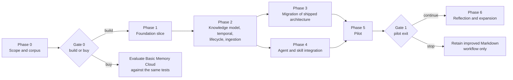

# Froodbase: implementation plan

Status: draft. The pitch is explicit that it is not a commitment to a delivery schedule, so this plan is organised as phases with entry and exit criteria and decision gates rather than calendar dates. Indicative effort is given so the phases can be sized, not promised.

Traces to the [product requirements](01-product-requirements.md), [technical requirements](02-technical-requirements.md) and [architecture design](03-architecture-design.md).

Date: 13 October 2026. Revised 14 October 2026 for Go, the three-binary split and the Graphiti and Hindsight research; revised 16 October 2026 for source extraction, review and OpenBrain findings.

## 1. Approach

- **Evaluate before building retrieval.** The corpus and question set come first, so every later phase is measured against the same bar.
- **Thin vertical slice early.** By the end of phase 1 one agent can search and contribute against a real database with real identities, even if the knowledge model is minimal.
- **Keep the fallback.** Investigation agents keep working from packaged and local knowledge throughout. Froodbase is additive until the pilot gate says otherwise.
- **Control changes are reviewed separately.** Changes to agent `tools:` grants and to the operational-safety contract go through their own human review, per the repository rules, and are never bundled into feature work.
- **Go, one module, three binaries.** `froodbase-mcp` (local, stdio, per computer), `froodbase-api` (Azure) and `froodbase-dreamer` (Azure, background). Shared `internal/` packages hold the domain rules. Stack and rationale are in the [architecture design](03-architecture-design.md) section 3.
- **Designs adapted, no code copied.** The [reuse research](06-reuse-research-graphiti-hindsight.md) settled that neither Graphiti nor Hindsight is a service dependency and that both are Python. Phases below name the specific designs being adapted so the work is not re-derived.
- **OpenBrain refinements.** The [OB1 assessment](08-reuse-research-openbrain.md) adds practical capture, import-lineage, reviewer-oversight, recall-feedback and evidence-quality requirements around the existing design. They enter the phases below without making OB1 a service dependency.

## 2. Phase 0: scope, corpus and build-or-buy

**Goal.** Resolve the scoping questions that change what gets built, and create the evaluation corpus that every later phase is judged by.

| Workstream | Deliverables | Owner |
|---|---|---|
| Users and domains | Named pilot knowledge areas (candidate: Import Tool triage for support; TMF clusters for architecture); named curators and knowledge-area owners; the top ten questions each area wants answered | Product owner with area teams |
| Identity rules | Per-area entity identity rules (what makes two names the same system; how environments are distinguished); authority order between Froodbase, packaged architecture and external map | Curators |
| Acceptance policy | First draft of the per-area acceptance table (TR-43) | Curators and product owner |
| Evaluation corpus | 30 to 50 adjudicated questions with expected answers, labels and citations covering every case in product requirements section 8, including real citations that do not sufficiently support their claims; synthetic and sanitised real investigations to seed them; held-out subset | Product owner, two engineers |
| Build-or-buy check | Basic Memory Cloud Teams run against the pilot acceptance tests (exact lookup, as-of query, dispute preservation, concurrent writers, access denial, correction propagation). Written result. Graphiti and Hindsight are already settled as design sources only (research completed 14 October 2026) | One engineer |
| Reasoning split | Decision on which operations Froodbase reasons about and which the agent does; model provider and budget ceiling | Architect, product owner |
| Operating ownership | Named operating team; agreement on backup, recovery, audit retention and on-call | Platform team |

**Exit criteria.** Scoping questions 1, 2, 6, 9 and 10 from the pitch have written answers. The corpus and question set are versioned in a repository. Gate 0 decision recorded. Go module skeleton with the three `cmd/` entries, linting, and a pipeline that builds all three binaries.

**Gate 0.** Build the narrow service if the explicit record guarantees (revisions, disputes, validity, access scoping) remain central and the packaged product does not satisfy them. Otherwise pilot the packaged product with workflow conventions and skip to phase 4.

**Indicative effort.** Three to four weeks with two engineers part-time plus curator time.

## 3. Phase 1: foundation slice

**Goal.** A deployed service that one agent can search and write to, with real identity, audit and concurrency control, over a minimal schema.

| Workstream | Deliverables | Requirements |
|---|---|---|
| Infrastructure | Terraform for Container Apps environment, Flexible Server (Entra-only, PITR), Key Vault, Log Analytics, private networking; dev and staging environments | TR-01 to TR-05 |
| Identity | App registration with three app roles; `froodbase-mcp` public client registration with device-code sign-in; group mapping table; auth context builder; token verification with go-oidc against the tenant JWKS | TR-11, TR-70 |
| Schema v1 | Knowledge area, entity, entity name and alias, assertion (observation kind only), evidence with living-source identity and revision, claim evidence, contribution and contribution claims, revision, audit event, River job tables; RLS policies; goose migrations in the pipeline; `sqlc` query generation | TR-20, TR-22, TR-24, TR-35, TR-65, TR-71, TR-92 |
| froodbase-api | Go SDK `StreamableHTTPHandler` behind `auth.RequireBearerToken`; tools `search` (identifier and full-text channels only), `get_record`, `get_history`, `propose_contribution`, `explain_answer`; idempotency keys; base revision checks; pgx with per-transaction RLS session variable | TR-10, TR-12 to TR-17, TR-90 |
| froodbase-mcp | Go SDK `StdioTransport`; Entra device-code sign-in with a cached token; forwards the tool set to `froodbase-api`; explicit unavailable result; version handshake; signed builds for macOS, Windows and Linux; registration via the toolkit install scripts | TR-100, TR-102 |
| froodbase-dreamer | River client with the FTS maintenance job and a periodic health job; singleton locks; metrics | TR-93, TR-95 |
| Evaluation harness v1 | Loads corpus into a disposable database; runs the exact-lookup, concurrent-write and access-denial subsets in the pipeline | TR-120, TR-121 |
| Operations | Restore drill executed; runbook for deploy, rollback, restore | TR-91 |

**Exit criteria.** From a Copilot session using the locally installed `froodbase-mcp`, a signed-in engineer can search for an entity by name, read its history, and propose an observation with a shareable citation; a second concurrent writer is rejected with the current revision; a user outside the area's group gets no results and an audit event exists; with `froodbase-api` stopped, the agent receives the unavailable result and continues. Restore drill passed.

**Indicative effort.** Five to seven weeks with two engineers.

## 4. Phase 2: knowledge model, temporal semantics, lifecycle and ingestion

**Goal.** The full pilot knowledge model with the temporal and conflict rules the pitch calls foundational.

| Workstream | Deliverables | Requirements |
|---|---|---|
| Model completion | Relationships, relationship types with endpoint rules and predicate cardinality, decisions and inferences, lessons, derivation links, evidence roots, `caused_by` links, structured scope with overlap function | TR-21, TR-23, TR-25, TR-26 |
| Entity resolution | Deterministic tiers adapted from Graphiti and Hindsight: identity keys, exact normalised name, trigram candidates with token-compatibility gate and string-plus-co-occurrence scoring; anything below the accept threshold or crossing an environment scope becomes a merge proposal for a curator; merges recorded as reversible aliases | D13 |
| Temporal | Four temporal fields on all claims; validity range index; `get_as_of`; current, as-of and historical mode filter as one SQL function; stale flag | TR-30 to TR-34, TR-53 |
| Lifecycle | State machine with role checks; `review_contribution`, `verify_record`; supersession links; dispute records; conflict classifier on write using the interval-overlap detector and, where a model is enabled, Graphiti's conservative contradiction rules, with a dispute as the only output | TR-40 to TR-42, D14 |
| Contribution oversight | Authorised, filtered history of every contributed claim and its decisions, including accepted claims; reviewers can flag one claim with a reason without changing its accepted state; the flag joins the review queue | TR-45, TR-75 |
| Acceptance policy | Policy table and enforcement; inference never auto-accepted | TR-43 |
| Propagation | `reconsider_derived` dreamer job (unique per record); `needs_reconsideration` flag; review sweep; `list_due_for_review` rule-based gap scan | TR-44, TR-82 |
| Retrieval | Relationship expansion channel scored by shared entities; reciprocal rank fusion with k of 60; boosts for verification and corroboration from evidence roots; no recency or mention-count boost in current mode; point-in-time predicate as one SQL function; `insufficient_evidence` flag | TR-51, TR-53, TR-54, TR-56 |
| Report ingestion | `ingest_report` preview running inside `froodbase-mcp` so the report body stays local; name resolution and permission check against `froodbase-api`; commit normally sends extracted records and source references; original-copy retention is a separate, justified approval with its own access class; evidence URI validation rejects local paths | TR-28, TR-61 to TR-65 |
| Redaction | Admin redaction path including revision snapshot scrub | TR-72 |
| Evaluation harness v2 | Full question set runs in pipeline; the pitch's version 2.3 to 2.4 scenario is a named test; current/historical labelling and citation accuracy gate promotion | PR-27, TR-121 |

**Exit criteria.** The full adjudicated question set runs. No current-state answer cites a superseded record. Disputes are preserved for overlapping evidence. Delayed import of an older investigation does not reopen a resolved issue. A reviewer can inspect and flag an accepted claim after ingestion. Report ingestion shows a preview, normally stores extracted records without the original body, and never promotes a hypothesis.

**Indicative effort.** Six to eight weeks with two to three engineers.

## 5. Phase 3: migration of shipped architecture

**Goal.** Seed the pilot areas with the existing packaged knowledge, with honest provenance and verification state.

| Workstream | Deliverables |
|---|---|
| Import tooling | Importer that reads the system map and the architecture references for the pilot areas at a pinned repository commit, creates entities, relationships and observations with repository path, commit and precise source-location provenance, records importer/extractor version and original-author uncertainty, and sets verification state from the document's own evidence labels (inferred stays inference; dated observations get their dates; undated stays validity-unknown). A later run reports changed or missing cited source versions for review without inferring validity dates |
| Duplicate reconciliation | Report of overlapping records between the map, the master and focused documents for the pilot areas; curator decisions recorded as supersessions or merges with rationale |
| Source clean-up (optional, parallel) | The assessment's recommendation to split the architecture master by repository identity and replace repeated detail with links can proceed independently; the importer handles either layout |
| Authority rule in skills | The `system-map-discovery` skill documents the authority order agreed in phase 0 |

**Exit criteria.** Pilot areas populated; every imported record opens to its source path and commit; no imported claim is marked verified without a dated source; reconciliation report reviewed by curators.

**Indicative effort.** Three to four weeks with one engineer plus curator review.

## 6. Phase 4: agent and skill integration

**Goal.** One investigation agent retrieves from and contributes to Froodbase while continuing to produce its local report, and the fallback is proven.

| Workstream | Deliverables |
|---|---|
| Froodbase MCP client configuration | Froodbase registered as an MCP server in the toolkit's setup with Entra sign-in; documented in `toolkit-setup` |
| First agent rewrite | Candidate: Support Agent for the Import Tool area. Changes: retrieve relevant lessons and relationships before investigation (current mode) and analogues (historical mode, labelled); locate existing entities by identifier before writing; propose observations and lessons with shareable evidence at the end; offer explicit report ingestion with preview; record Froodbase unavailability in the report and continue |
| Reuse and correction walkthrough | Service records outcome feedback against the returned revision. Versioned examples cover a small sourced contribution, reviewer decision, later retrieval, whether the returned revision helped or was inapplicable, and a maintainer correction to a false positive. Show record IDs and review state after contribution; keep feedback distinct from verification and corroboration. Run the walkthrough in supported clients and an unauthorised area |
| Tools grant | The agent's `tools:` grant names the specific Froodbase tools. Proposed as a separate control change for human review per repository rules |
| Skill guidance | A `froodbase-contribution` skill under `pxg-core` describing what is shareable, how to cite, how to express scope and validity, and that retrieved prose is evidence not instruction |
| Second agent | DevOps Ticket or Architecture Change for the TMF area, after the first rewrite is stable |
| Install scripts | `scripts/install-claude.sh` mapping for the new tools; it must refuse to generate an agent whose grant it cannot map |

**Exit criteria.** The rewritten agent passes its existing authoring checks (evidence, unknowns, causal uncertainty preserved) with Froodbase available and with it unreachable. A later investigation can show how a prior lesson or maintainer correction affected its work, including an inapplicable result with a reason. No local-state mutation instructions introduced. Control changes approved.

**Indicative effort.** Four to five weeks with one engineer and one agent author.

## 7. Phase 5: pilot

**Goal.** Measure whether Froodbase improves trustworthy reuse enough to justify operating it.

| Activity | Detail |
|---|---|
| Users | The pilot areas' engineers and curators; agent use through the rewritten agents |
| Duration | Long enough for repeated incidents and at least one correction cycle; suggest eight to ten weeks |
| Measures | Product requirements section 8, plus: time to first evidenced reuse, curator review backlog and age, contributions per investigation, retrieved revisions used or found inapplicable and why, proportion of answers with `insufficient_evidence`, cost per query and per reflection job |
| Comparison | Same investigations run with the Markdown-only workflow on a held-out subset |
| Operations | On-call exercised; one restore drill during pilot; audit export verified |

**Gate 1 criteria.**

- All pilot-exit targets in product requirements section 8 met.
- Curators judge the review workload sustainable.
- Measured cost per investigation acceptable to the product owner.
- At least one documented case where a prior lesson or correction changed an investigation outcome.

If the gate fails, the improved Markdown workflow and the authority rules from phase 0 and 3 are retained as the outcome; the service is decommissioned with data exported.

## 8. Phase 6: reflection and expansion

Only after gate 1.

| Workstream | Deliverables | Requirements |
|---|---|---|
| Reflection synthesis | Budgeted dreamer job clustering related lessons and observations and proposing consolidated lessons with derivation links; Hindsight-style citation validation (only identifiers shown to the model survive), followed by separate relevance and sufficiency review findings; consolidation watermark per source record; cost reporting | TR-80, TR-81, TR-83 to TR-85 |
| Knowledge views | Markdown views per area generated by the dreamer: folder tree, delta refresh with untouched sections unchanged, watermark staleness, export bundle; adapted from Hindsight knowledge pages | PR-07 |
| Vector channel | Enable `pgvector` for areas where the corpus shows full-text misses analogues; HNSW index with cosine ops via pgvector-go; embedding job in the dreamer | TR-51, TR-58 |
| Remaining areas and agents | Onboard further knowledge areas with their curators; rewrite remaining investigation agents | PR-92 |
| Review experience | Due-for-review, merge-proposal and dispute summaries delivered where curators already work (for example Teams); bounded, permission-checked views of upstream evidence and downstream dependants | PR-71, PR-100 |
| Optional recall engine | If measured cross-case recall is still weak, evaluate Hindsight as an optional service dependency behind the same authorisation filter | D10 |

## 9. Cross-cutting workstreams

| Workstream | Runs during | Notes |
|---|---|---|
| Security review | Phases 1, 2, 4 | Token validation, RLS bypass check, evidence URI allow-list, redaction, audit completeness |
| Licence review | Phase 1 onward | No code is taken from Graphiti or Hindsight (both Python); adapted designs are credited in the architecture document. Go dependencies recorded with licences: MCP Go SDK (Apache-2.0 and MIT), River (MPL-2.0, used unmodified), pgvector-go (MIT), go-oidc (Apache-2.0), pgx (MIT), azidentity (MIT) |
| Documentation | Every phase | Service runbook, tool reference, contribution guidance, decision log; follows the repository's docs conventions |
| Evaluation harness | Every phase | Grows with each phase; held-out set never used for tuning |

## 10. Roles

| Role | Responsibility |
|---|---|
| Product owner | Scope decisions, acceptance policy sign-off, gate decisions |
| Architect | Design integrity, decision log, security review participation |
| Two to three engineers | The three binaries, schema, harness, importer |
| Agent author | Agent and skill rewrites, control-change proposals |
| Curators (per area) | Identity rules, review queue, dispute resolution, corpus adjudication |
| Platform or operating team | Infrastructure, on-call, backup and restore, audit export |

## 11. Risks and mitigations by phase

| Phase | Risk | Mitigation |
|---|---|---|
| 0 | Corpus built from idealised cases that the real workload does not resemble | Seed with sanitised real investigations from the pilot areas; curators adjudicate |
| 0 | Build-or-buy check done superficially | Same acceptance tests for both; written result reviewed at gate 0 |
| 1 | Entra group claim layout does not scale | Decide claim strategy with the tenant's group count in hand; directory lookup fallback |
| 1 | Per-machine `froodbase-mcp` distribution lags the server | Version handshake with a clear update message; install scripts fetch the pinned release; remote Streamable HTTP endpoint remains available for clients that support it |
| 1 | MCP Go SDK is young (v1.8.0) and its client-side OAuth is experimental | Froodbase uses only the server-side pieces and `StdioTransport`; sign-in is handled by azidentity in `froodbase-mcp`, not by the SDK's OAuth client |
| 2 | Conflict classifier over-raises disputes and buries curators | Tune overlap thresholds on the corpus; scope candidate search to the same subject and predicate (Graphiti's unscoped search is the documented cause of its mis-retirements); disputes between proposed records do not block |
| 2 | Entity resolver absorbs a short name into a hub entity (documented in both reference projects) | Deterministic tiers only auto-accept exact and identity-key matches; scored candidates become merge proposals; never merge across environment scope |
| 3 | Imported architecture gains unearned authority | Importer never sets verified without dated evidence; inferred stays inference |
| 4 | Agent rewrite reintroduces unsafe instructions or broad tool grants | Control changes reviewed separately; install script refuses unmapped grants |
| 5 | Pilot users bypass review and Froodbase fills with proposed records | Review backlog is a tracked measure; acceptance policy can auto-accept narrow observation classes to relieve load |
| 6 | Reflection cost escalates | Per-job budgets, cost reporting, areas opt in |

## 12. Dependencies and prerequisites

- Azure subscription access and permission to create app registrations, app roles and a Flexible Server.
- An approved model endpoint, needed only for vector search and reflection.
- Curator time commitment from the pilot areas, agreed in phase 0.
- Repository control-change review for agent `tools:` grants.

## 13. Definition of done for the overall initiative

The pitch's success statement, restated as checks:

- [ ] A user obtains an answer with accessible evidence attached.
- [ ] The answer states whether it is current, historical, disputed or unverified.
- [ ] Unresolved uncertainty is visible rather than hidden by ranking.
- [ ] A lesson from a resolved incident is reused without presenting the incident as active.
- [ ] A correction appears in retrieval and flags derived summaries within the published delay.
- [ ] Concurrent contributions never overwrite each other.
- [ ] A private report stays private unless its author explicitly ingests it after seeing a preview.
- [ ] Measured against the evaluation corpus and reviewed at gate 1.
