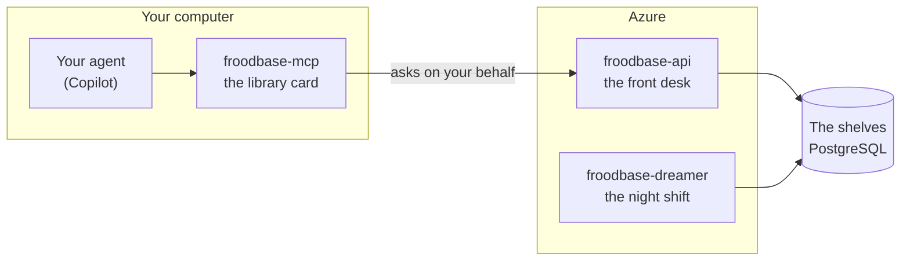
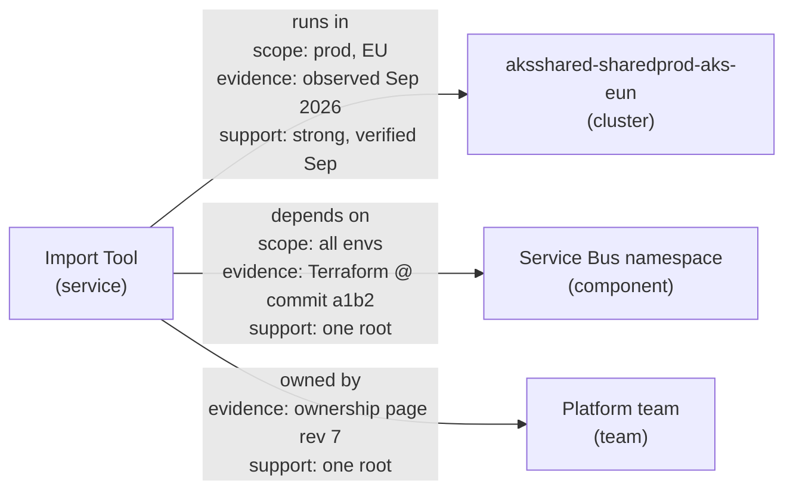
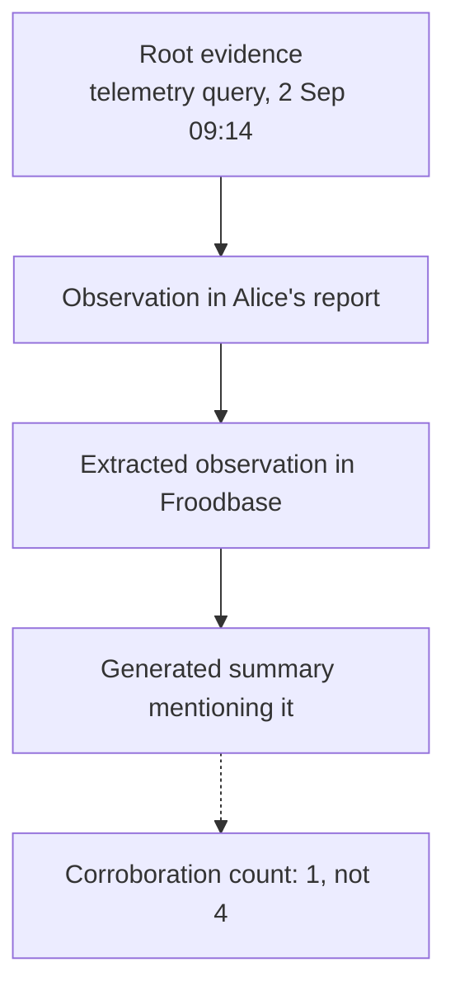
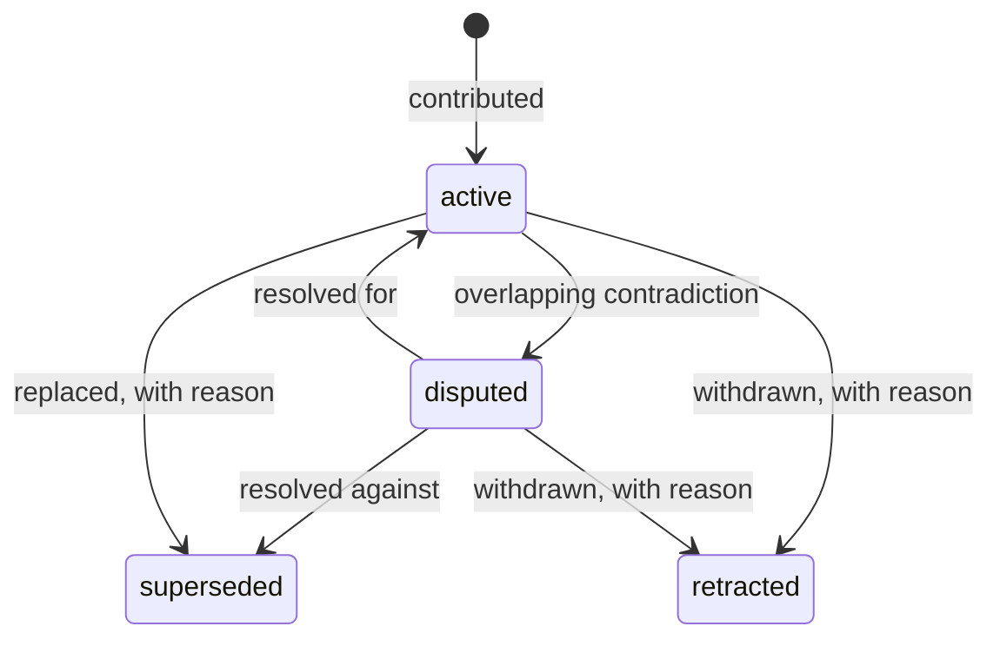
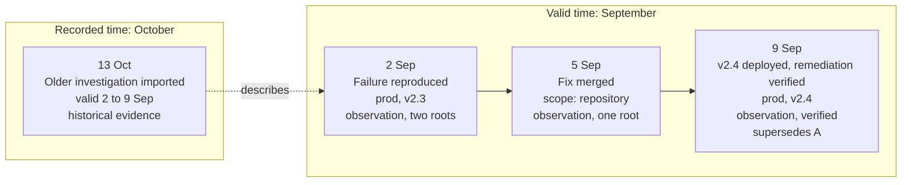
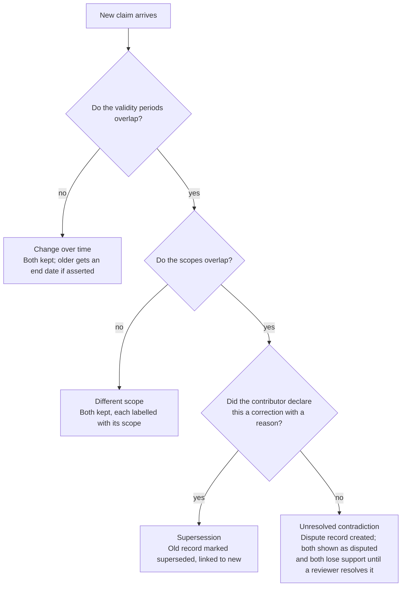
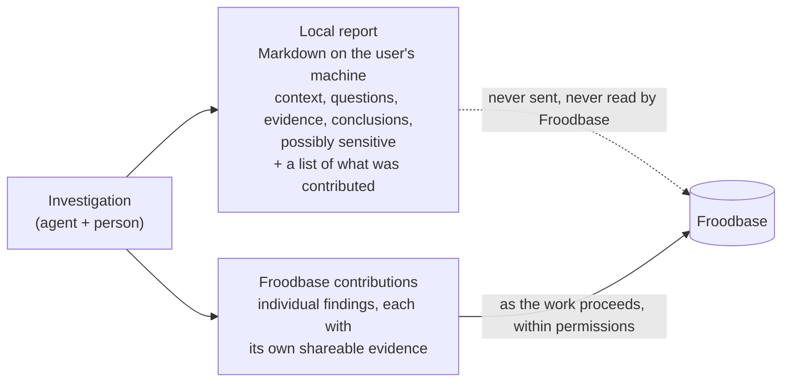
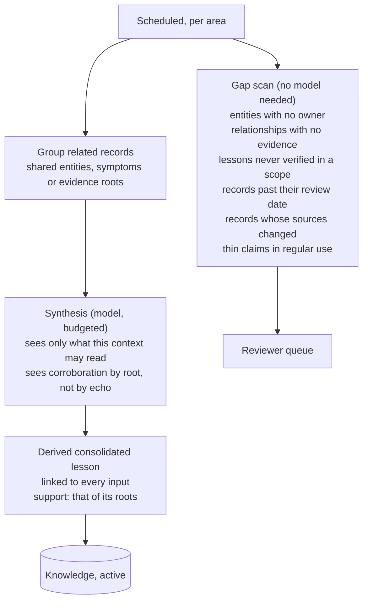

# How Froodbase works

A plain-language, technical explanation of the ideas behind Froodbase: relationships, provenance, change history, temporal correctness, retrieval, learning and reflection. It is written for someone meeting these concepts for the first time. It describes *what the mechanisms do and why*, not how the code is written.

Companion documents: the [product requirements](01-product-requirements.md) say what must be true; the [architecture design](03-architecture-design.md) says how it is built.

Date: 13 October 2026. Revised 14 October 2026 for the three parts of Froodbase and the Graphiti/Hindsight findings; revised 16 October 2026 for living sources and human oversight, and again the same day so that certainty is earned from evidence and use rather than granted by approval.

## 1. The one-paragraph version

Froodbase is a shared memory for what we know about our systems. Unlike a wiki, every piece of knowledge in it carries three extra things: **where it came from**, **when it was true**, and **how sure we are**. Unlike a search engine, when you ask it a question it does not just find the most similar text; it works out which records actually apply to your situation right now, tells you which are history, and refuses to pick a winner when the evidence disagrees. Unlike a notebook, it never erases: corrections are added on top, so you can always see what we used to believe and why we changed our minds. And unlike an approval workflow, nothing in it waits for a signature: a claim becomes more certain as independent evidence arrives and as people use it and report that it worked.

## 2. An analogy to hold onto

Think of three familiar things combined:

| Familiar thing | What it contributes | Froodbase concept |
|---|---|---|
| A **pinboard with string** in a detective's office | Named things connected by labelled threads | Entities and relationships |
| A **court record** | Every claim has an exhibit number, a witness and a date; nothing is struck out, only overruled | Provenance and change history |
| A **newspaper archive with a corrections column** | You can read what was printed on any given day, and separately see what was later corrected | Temporal correctness |

The rest of this document walks through each piece.

## 2a. The three parts of Froodbase

Froodbase is one program built three ways, each with a different job. Think of a library.

| Part | Where it runs | Analogy | What it does |
|---|---|---|---|
| **froodbase-mcp** | On each engineer's computer, started by the editor | Your library card | Knows who you are (it signs you in once and remembers) and carries your questions and contributions to the front desk. It never reads your notes, your conversation or your report. If the library is closed, it tells your agent plainly so the agent can carry on with what it has locally. |
| **froodbase-api** | In Azure | The front desk | Checks your card, works out which shelves you may see, answers questions, files contributions, records what happened when you used something, and writes every transaction in the ledger. |
| **froodbase-dreamer** | In Azure, in the background | The night shift | Does everything that does not need someone waiting: re-indexing, recomputing how well-supported things are when evidence changes, crediting records that are in steady use without complaint, sweeping for records due for review, looking for gaps, drafting consolidated lessons, and regenerating readable summaries. Its drafts are ordinary derived records that earn support like anything else. |

The name "dreamer" is a reminder of what sleep does for memory: consolidating the day's experiences, linking them to older ones, and tidying up, without creating new facts about the world.

## 3. Entities and relationships: the pinboard

### Entities

An **entity** is a thing we talk about repeatedly: a service, a cluster, a team, an environment, an incident. Each gets a permanent identity card in Froodbase. The card's number never changes, even if the thing is renamed, moved or re-platformed.

Why does this matter? Because names are unreliable. Our system map already shows the trap: the Import Tool runs in an EU cluster that was observed in September, and a US cluster whose name is "unverified and must be resolved rather than inferred". If Froodbase keyed knowledge on names, "import tool production" would silently blend two different places. With identity cards, those are two entities, each with its own evidence, and a curator decides whether they are related.

### Relationships

A **relationship** is a labelled thread between two entity cards: *depends on*, *owned by*, *deployed to*, *runs in*. The crucial difference from a diagram in a document is that every thread carries its own passport:

- **Evidence**: which exhibit shows this thread exists (a Terraform file at a given commit, a telemetry query, a ticket).
- **Scope**: where the thread applies (production only? version 2.x? the EU region?).
- **Validity**: from when to when the thread was true.
- **Support**: how well evidence and experience back it.
- **State**: active, disputed, superseded or retracted.

Because the threads are records rather than prose, Froodbase can answer "what depends on the Service Bus namespace in production?" by following threads backwards, without hoping an agent reads the right paragraph.

### Three kinds of statement

Not every thread or fact is the same kind of knowledge. Froodbase insists on labelling each **assertion** as one of:

| Kind | Means | Example |
|---|---|---|
| **Observation** | Someone looked and saw this | "Pod restarts spiked at 09:14 on 2 September in prod" |
| **Decision** | Someone with authority approved or intended this | "Architecture review approved moving the queue to Service Bus Premium" |
| **Inference** | Someone concluded this from other things | "The restarts were probably caused by the queue throttling" |

The analogy is a court again: an observation is eyewitness testimony, a decision is a ruling, an inference is the barrister's argument. All three are valuable. None of them is allowed to impersonate another, however well supported it becomes. In particular, the pitch's rule holds: *an observed deployment does not repeal a decision, and an approved design does not prove the deployment matches it.* Froodbase stores both and shows you the gap between them.

## 4. Provenance: where did this come from?

**Provenance** is the chain of custody for a piece of knowledge. For every assertion, relationship or lesson Froodbase records:

- The **source**: a link to something the reader can actually open, plus the exact revision (a commit, a ticket version, a query with its time window).
- The **contributor**: which person, and if an agent did the work, which agent on that person's behalf.
- The **time** it was recorded.

Repositories, Confluence pages and other documents can keep changing. Froodbase stores the extracted claim and a precise reference to the version examined, never a copy of the document. A short supporting excerpt can help a reviewer understand an older claim after the live page changes. A changed page lowers the claim's support and invites a fresh look; it does not tell Froodbase when the claim stopped being true.

### Why a private file path is not a citation

If the only evidence for a claim is `/Users/alice/tickets/PX-1234/findings.md`, nobody else can check it. Froodbase rejects that kind of reference. A shareable contribution has to bring its own shareable evidence: the ticket link, the commit, the telemetry query. Alice's report, and the conversation that produced it, stay on her machine; they are never an input to Froodbase. What her agent contributes are the individual findings it can cite, and her report lists what was sent so she can retract any of it.

### Evidence roots: not counting an echo three times

Here is a subtle trap. Suppose one engineer observes a failure and writes it in a report. An agent extracts that observation into Froodbase. Later, a summary is generated that mentions it. A naive system now has three records saying the same thing and might treat the claim as triply confirmed.

Froodbase keeps a **derivation link** from each restatement back to its **root**: the original observation. When it counts how well-supported a claim is, it counts distinct roots, not records.

An analogy: if you hear a rumour from three friends who all heard it from the same person, you have one source, not three.

### Derived knowledge is always marked derived

Anything Froodbase or an agent *concluded* (an inference, a consolidated lesson, a reflection summary) is stored with links to everything it was concluded from. Two consequences follow:

1. You can always see the working.
2. If any input changes (a source is corrected, retracted or superseded), the derived record's support drops and, when it falls below the area's threshold, it is flagged **needs reconsideration**. The conclusion does not quietly outlive its evidence.

### Support: how sure are we, and why

Three labels answer three different questions. **Kind** says whether the statement was observed, decided or inferred, and never changes. **State** says whether the claim is active, disputed, superseded or retracted. **Support** is the certainty level: a score built from an append-only list of events, so you can always see what earned it.

| Support goes up when | Support goes down when | Support ignores |
|---|---|---|
| A new, independent evidence root is linked | A contradicting claim overlaps it (a dispute) | How many times it was retrieved |
| Someone re-checks it against fresh evidence on a known date, in a scope | Someone applied it and it did not work, with evidence | How many documents repeat it |
| Someone applied it and reports, with evidence, that it worked | A cited source changed or disappeared | How confident the model that wrote it was |
| It stays in use for a while and nothing challenges it (a small, capped credit) | A reviewer flags it, or a record it relied on is retracted | How fluent the text is |

The third row is the important one. Froodbase treats a successful, evidenced use of a lesson as what it is: a fresh observation, in a new place and time, that the lesson holds. That is the same thing as verification, and it needs no reviewer. The fourth row is deliberately weak: quiet use adds a little, is capped, and can never on its own carry an inference across its area's threshold. Reading something proves nothing, so retrieval adds nothing at all.

## 5. Change history: never erase, only add

Froodbase is **append-only**. Every record has a revision number. Changing it creates a new revision; the old one remains readable. This is the same discipline as an accountant's ledger or a version control system: you correct a mistake by adding an entry, not by rubbing out the old one.

The lifecycle is deliberately small:

| Move | What it means | Who or what does it |
|---|---|---|
| **Contribute** | A new claim enters, active, with the support its evidence gives it | Any contributor, any agent on their behalf, the dreamer |
| **Verify** | Fresh evidence was checked on a known date; support rises | Anyone with evidence, including an agent reporting an outcome |
| **Dispute** | Two active claims overlap in scope and time and disagree; both lose support until resolved | Raised automatically, resolved by a reviewer |
| **Supersede** | A newer claim replaces an older one, with a stated reason | The contributor making the correction, or a reviewer |
| **Retract** | A claim is withdrawn, with a reason; it stays readable as history | Its contributor, or a reviewer |
| **Flag** | A reviewer records a doubt; support drops and the claim joins the review queue | Reviewer |

A superseded or retracted record is not deleted. It is history. A current-state question skips it; a historical question still finds it, labelled, and pointing at its replacement or its reason.

A reviewer can inspect the complete contribution history for their knowledge area whenever they wish, with every claim's support events and decisions. They can flag one claim with a reason if its source, scope or conclusion looks doubtful. The flag lowers its support and brings it to review without changing its state. This history shows *what knowledge entered and how its certainty changed*; the operational audit log separately records *who performed each action*.

### Why "generated" never means "certain"

Agents and reflection jobs can write fluent, confident prose. Froodbase treats that fluency as irrelevant to trust. Anything generated is stored labelled derived and inferred, with exactly the support its cited roots give it, which is usually thin. It earns more the same way everything else does: independent roots, verification, and people using it and reporting that it worked. Nobody has to approve it, and nothing it says about itself counts. A reviewer can inspect, flag or retract it at any time, so review is oversight and correction rather than a gate on every record.

### Concurrency: no silent overwrites

If two people (or two agents) edit the same record at the same time, the second one to save is told "this record changed since you read it; here is the current version". They rebase and try again. Nothing is lost. The analogy is a shared document that refuses to let you paste over someone else's paragraph without seeing it first.

## 6. Temporal correctness: two clocks, not one

This is the idea the pitch calls foundational, and it is the one most systems get wrong.

### The problem with "newer wins"

A search index ranks by relevance and often by recency. That works for news. It fails for operational knowledge because *when we wrote something down* and *when it was true* are different things:

- We import an old incident report today. It is new to Froodbase, but it describes September.
- Someone speculates today about a cause. It is new, but it is thinly supported.
- A fact verified in May may still be true in October. Age does not make it wrong.

### The two clocks

Every claim in Froodbase carries two independent timelines, plus two more dates:

| Field | Question it answers | Example |
|---|---|---|
| **Valid from / valid to** | When was this true in the world? | True from 2 Sep (failure began) to 9 Sep (fix deployed) |
| **Recorded at** | When did Froodbase learn it? | 13 Oct (imported late) |
| **Verified at** | When did someone last check it against evidence? | 9 Sep |
| **Scope** | Where is it true? | Production, EU, version 2.3 |

The newspaper analogy: *valid time* is the date of the events in the story; *recorded time* is the date the edition was printed. An archive lets you ask "what did we print on 3 September?" (recorded time) and "what was actually happening on 3 September, including things we learned later?" (valid time). Those are different questions with different answers, and Froodbase can answer both.

### Unknown stays unknown

If a contributor does not know when something started or ended, Froodbase leaves those dates empty and labels the record "validity unknown". It never fills in the recording date as a guess. And an empty end date means "we do not know that it ended", **not** "it is verified current". Those are different claims and Froodbase shows them differently: a record with an empty end date and an old verification date is returned with a *stale* warning, not hidden and not presented as fresh.

### The worked example

The pitch gives a sequence. Here is how Froodbase stores it and what each kind of question gets back.

| Question asked | What Froodbase returns | Why |
|---|---|---|
| "Is the callback failure a current problem in prod?" (current mode) | The 9 Sep verified remediation; the failure is shown as superseded | The failure's validity ended and it was superseded by a verified observation in the same scope |
| "What was going on in prod on 3 September?" (as-of mode) | The 2 Sep failure, labelled historical | On 3 Sep the failure was valid and nothing had superseded it yet |
| "Have we seen callback failures like this before?" (historical mode) | The failure, the fix, the deployment, and the imported investigation, each labelled with its status relative to now | Troubleshooting wants analogues, clearly marked as past |
| Does the 13 Oct import reopen the issue? | No | Its valid time is September; recording it late changes nothing about current state |
| Does the 5 Sep merge resolve the issue? | No | Its scope is the repository, not production; only the verified deployment supersedes the failure |

### Scope: same name, different place

"Springfield" is a town in many US states. "Import Tool" exists in several environments. Scope is a structured label on every claim: environment, region, version range, cluster, tenant. Two claims only *conflict* if their scopes overlap. "Workaround X applies in staging" and "Workaround X does not apply in production" are not a contradiction; they are two scopes. Froodbase compares scopes with one shared rule, so conflict detection and question filtering always agree.

## 7. Conflicts: preserve the disagreement

When a new claim arrives, Froodbase looks for existing active claims about the same subject with overlapping scope and time. Then it asks, in order:

The last branch is the important one. Most systems would pick a winner (newest, highest-ranked, most-cited). Froodbase refuses. It records a **dispute**, shows both sides to anyone who asks, and puts it in a reviewer's queue. This is the one place where a person must decide. The analogy is a good editor who, faced with two sources that disagree, prints "accounts differ" rather than guessing.

Age alone never resolves a dispute, never deletes a lesson and never raises support. A durable fact from last year is still a fact; it may simply be *due for review*.

## 8. Retrieval: how a question becomes an answer

Retrieval is where everything above pays off. When an agent or person asks a question, Froodbase runs a pipeline rather than a single search.

```mermaid
flowchart LR
    Q["Question<br/>+ scope + mode"] --> CH

    subgraph CH["1. Find candidates four ways"]
        direction TB
        ID["Exact identifiers and names<br/>(catalogue number)"]
        FT["Full-text search<br/>(index at the back of the book)"]
        VS["Semantic similarity<br/>(a librarian who knows what you mean)"]
        GR["Relationship threads<br/>(follow the string on the pinboard)"]
    end

    CH --> P["2. Permission filter<br/>remove anything the asker may not see"]
    P --> M["3. Mode filter<br/>current / as-of / historical"]
    M --> R["4. Rank and fuse<br/>best-supported and best-matching scope first;<br/>no 'newer text wins'"]
    R --> X["5. Explain<br/>why each record was kept or dropped"]
    X --> A["Answer with citations, kind, state,<br/>support, scope, validity and warnings"]
```

### The four ways of finding things

| Channel | Analogy | Good at | Weak at |
|---|---|---|---|
| **Exact identifier** | Looking up a catalogue number | Known ticket keys, service names, record ids | Anything you cannot name precisely |
| **Full-text** | The index at the back of a textbook | Specific words: an error string, a cluster name | Same idea in different words |
| **Semantic similarity** | A librarian who understands "that thing where the callbacks time out" | Analogous incidents described differently | Precision; it can be confidently wrong |
| **Relationships** | Following the string on the pinboard | "What depends on this?", "who owns that?" | Anything not yet connected by a thread |

Running all four and merging the results is called **hybrid retrieval**. Semantic similarity needs a model to turn text into comparable numbers (embeddings); the other three do not, so Froodbase works without any model at all and adds the semantic channel only where it proves useful.

### Permissions come before cleverness

Step 2 happens *before* ranking, before snippets are built and before any model is involved. If you cannot read a record, it is not in the pile when ranking starts. That rule applies equally to summaries, counts, embeddings and relationship threads, so a restricted fact cannot leak through a side door such as "there are 3 related incidents" or a relationship arrow pointing at something you cannot open.

### Mode: which clock are we reading?

| Mode | Keeps | Use when |
|---|---|---|
| **Current** | Active and disputed records valid now (or end unknown, flagged stale if unverified for a while); superseded and retracted records are left out | "What is true now?" |
| **As-of** | Whatever was valid at the given moment, regardless of when it was recorded | "What was the architecture during the incident?" |
| **Historical** | Everything, each item labelled with its status relative to now | "Have we seen this before?" |

Every record in every mode comes with its kind and its support, so a thinly supported inference is visible as exactly that rather than hidden until someone approves it.

### Ranking without "newer wins"

In current mode, how recently something was *written down* is not a ranking signal, and neither is how often it is mentioned. What counts: how well supported it is, how recently it was verified, how closely its scope matches the question. A fact verified in May and used successfully since outranks an unverified speculation from yesterday.

### Saying "we don't know"

Each knowledge area sets a support threshold per kind of claim: how certain is certain enough to answer without a warning. If the best candidates are below that threshold, or disputed, the answer carries an explicit *insufficient evidence* flag. The pitch asks for visible uncertainty; this is where it surfaces. The threshold is a setting on the area, not a gate on the record: the record is there, retrievable and earning support either way.

### Explain

Every search keeps a trace of each candidate and the rule that kept or dropped it. Asking "why did I get this answer?" replays that trace. This is also how the evaluation corpus checks Froodbase's behaviour mechanically.

## 9. Learning: how an investigation becomes shared knowledge

### Two outputs, one investigation

An investigation produces two separate things:

The report is the user's. It can contain anything: the conversation, the user's questions, customer details, dead ends. None of it reaches Froodbase, ever, and `froodbase-mcp` never reads it. What crosses the boundary are the **pieces**: as the investigation proceeds, the agent contributes each finding it can back with a shareable citation (the telemetry query, the commit, the ticket). Each contribution is small, checkable and listed in the report by identifier, so the person can see afterwards what was shared and retract anything that should not have been. The original worry behind "reports stay local" was never that a finding needs a signature; it was that a whole report, with the conversation in it, must not be dumped into the shared store. The pieces are what we want, not the whole.

Hypotheses enter as *inferences* with thin support. They stay visibly thin until independent evidence or a successful use strengthens them. Importing an old report works the same way: a skill reads the file on the user's machine, extracts what it can cite, and contributes those findings; the file itself is not sent.

### What a lesson looks like

A **lesson** is the reusable shape of an experience. It is not "what happened" (that is the incident record); it is "what to try next time, and when it applies". Its sections:

| Section | Question it answers |
|---|---|
| Symptoms | What did we see? |
| Conditions | What had to be true for this to happen? |
| Unsuccessful approaches | What did we try that did not work, so nobody repeats it? |
| Remedies | What actually fixed it, and how well is that supported? |
| Applicability | Where and when does this apply, and where do we not know? |

The last section is what stops a lesson from becoming a trap. "Restart the ingestion pod" might have fixed version 2.3 in staging and be useless or harmful for 2.4 in production. Applicability says so, and Froodbase compares it against the scope of the question before offering it.

### Outcomes: how experience becomes certainty

When an agent or person uses a retrieved lesson, they can tell Froodbase what happened. "I applied the remedy in prod EU on 9 September; here is the telemetry showing the restarts stopped" is a new observation with its own evidence root. Froodbase links it to the lesson, raises the lesson's support, and extends its verified applicability to prod EU. "I tried it and it made no difference; here is the telemetry" lowers the lesson's support, and if the evidence contradicts the lesson outright, raises a dispute. "It did not apply to my situation because the version was different" is recorded so that ranking can learn, but changes nothing about the lesson's certainty. "I read it" changes nothing at all.

This is the mechanism that lets knowledge progress on its own. An inference that is right will be used, will work, and will be seen to work, in more places over time. One that is wrong will fail, and the failure is recorded against it. Neither path needs a reviewer.

### Thresholds: how certain is certain enough

Each knowledge area decides, per kind of claim, how much support an answer needs before it is given without a warning. An observation with one good source might clear its threshold at once; an inference might need two independent roots, or one root and a successful use. The area also sets how much weight each kind of event carries, within limits the service enforces, and caps the quiet-use credit. The dreamer applies these settings; people set them and handle disputes, flags and corrections rather than approving records.

## 10. Reflection: what the dreamer does at night

Reflection is Froodbase stepping back from individual records to ask what they add up to. It is the dreamer's job: it runs in the background, per knowledge area, with a budget, and it produces derived records that earn support like any other.

Two halves:

- **Gap analysis** is rule-based. It needs no model and asks simple questions: who owns this with no owner on record? Which thread has no evidence? Which lesson has never been verified in production? What has gone past its review date? What derived record has a source that changed? Which thin claim is being used every week and deserves a look? The output is a to-do list for curators.
- **Consolidation** groups related records (three incidents touching the same component with similar symptoms, say) and, within a token budget, asks a model to draft a single lesson. The dreamer remembers exactly which records it showed the model; any citation outside that list is struck out, and a draft left with no valid citations is thrown away. The draft is stored active, labelled derived, with derivation links to every input and the support of their distinct roots. From there it earns support like any other lesson: independent evidence, verification and successful use. The dreamer also keeps a bookmark per record of what has already been consolidated, so the same evidence is not re-read every night.

The dreamer also maintains the **readable summaries**: Markdown pages per knowledge area, organised in folders, each generated from records above the area's threshold. It refreshes a page only when something it read has changed (it keeps a bookmark of the newest revision it saw), and it changes only the sections affected, so a diff of the page is readable. Because Froodbase never deletes, a correction, retraction or redaction is itself a new revision, so the page cannot keep claiming to be current after something it cites was withdrawn.

The analogy is a team retrospective. The facilitator (gap scan) lists what is missing or overdue. The group (synthesis) connects the dots across several incidents and drafts a change to the runbook. The draft is filed where everyone can see it, marked as a draft with its sources; it becomes trusted when people try it and it works, and it is challenged when it does not.

Reflection also respects permissions the same way retrieval does: a summary is only ever built from records its intended readers could see themselves. It never launders restricted evidence into an unrestricted conclusion.

## 11. Putting it all together: one incident over time

Follow a single case through the whole system.

1. **September 2, investigation.** The Support agent, acting for Alice, asks Froodbase in *current* mode about Import Tool callback failures and in *historical* mode for analogues. It gets one old lesson from 2025, labelled historical, applicability "staging only, unverified in prod", support thin. During the investigation the agent contributes one observation ("restarts spiked at 09:14, prod, v2.3", telemetry query cited), which is active with one root, and one inference ("likely queue throttling"), active, labelled inferred, with thin support because correlation alone is one root. Alice's local report, with her questions and the customer's details, stays on her machine; it lists the two record identifiers.

2. **September 5, fix merged.** A DevOps agent contributes an observation that PR 418 merged, scope: repository. No conflict with anything in production; both records stand.

3. **September 9, deployed and verified.** The deployment agent contributes the observation that v2.4 is in production and the failure no longer reproduces, with the post-deploy telemetry cited, and reports an **outcome** against Alice's inference: the fix built on the throttling diagnosis worked, here is the evidence. The inference gains a second, independent root and an `outcome_succeeded` event, and crosses the area's inference threshold. The deployment agent also declares the failure observation superseded with reason "remediated in 2.4". The dreamer recomputes anything that depended on the old observation. No reviewer was involved.

4. **October 13, late import.** Bob finds an older investigation report and asks his agent to share what it can. The agent reads the file locally, extracts historical evidence valid 2 to 9 September and two hypotheses, contributes them with their citations, and lists the identifiers in Bob's notes; the report file and the paragraph of customer details in it never leave his machine. Current-mode queries are unchanged. As-of queries for early September now have richer evidence. Bob's restatement of Alice's telemetry is linked to the same root and adds no corroboration.

5. **November, reflection.** The gap scan notes the 2025 lesson is still unverified in production. Consolidation groups the 2025 lesson, Alice's case and Bob's import and drafts a lesson: symptoms, the throttling condition, the failed restart approach, the 2.4 remedy, applicability "prod EU, v2.3 and earlier; unverified for US". It is stored active, derived, with the support of its three distinct roots.

6. **December, a new engineer.** Carol asks "is the callback failure still a problem?" Current mode returns the verified 2.4 remediation and the consolidated lesson, with its support shown. She applies the lesson's remedy to a similar incident in prod US, it works, and her agent reports the outcome with the telemetry. The lesson's applicability now covers prod US and its support rises again. She asks "why?" and sees that the September failure was excluded because it is superseded, and that the 2025 lesson was excluded from current mode because its applicability does not cover production. She can follow every citation.

7. **January, a reviewer.** The platform lead, browsing the area's history, doubts one of Bob's imported hypotheses and flags it. Its support drops and it joins the queue; nothing else changes until she decides. Everything else earned its place without her.

Nothing was erased. Nothing was taken on trust because it was fluent, and nothing waited for a signature. The old incident never looked live. Bob's late import never reopened it. And the private parts of two reports stayed private.

## 12. What we learned from Graphiti and Hindsight

Two open-source projects solve neighbouring problems and were studied closely before the design was settled. The full findings are in the [reuse research](06-reuse-research-graphiti-hindsight.md). Both are written in Python, and Froodbase is written in Go, so nothing is copied; what matters is which ideas are borrowed and which are deliberately refused.

**Graphiti** (from Zep) builds a graph of entities and relationships from text, with the same two clocks this document describes: when a fact was true and when the system learned it. Every fact remembers which "episode" (a document or message) asserted it. That shape is exactly Froodbase's, and it is reassuring that a widely used system arrived at it independently.

**Hindsight** (from Vectorize) stores extracted facts in PostgreSQL, finds them four ways at once (meaning, words, connections, time), merges the results, consolidates them into "observations" in the background, and writes readable knowledge pages that refresh themselves. Its retrieval and its knowledge pages are the model for Froodbase's.

Where Froodbase parts company with both, it is because its automatic decisions must be earned from independent evidence and remain auditable. People correct exceptions; they do not approve records.

| They do this | Froodbase does this instead | Why |
|---|---|---|
| If a fact is in the present tense and has no date, assume it became true when it was written down | Leave the date unknown and say so | Writing-down time is not truth time (section 6) |
| When a new fact seems to contradict an old one, the model marks the old one as ended | Record a dispute and show both until a reviewer decides | Graphiti's own issue tracker shows most automatic retirements it audited were wrong |
| Let the model write the sentence that gets stored, and summaries of entities and clusters, and serve them immediately | Store the generated claim labelled derived and inferred with only the support of its roots; it earns more from independent evidence and successful use, never from itself | Fluency is not evidence (section 5) |
| Rank a fact higher the more times it has been mentioned | Count distinct sources of evidence and evidenced outcomes | Three friends repeating one rumour are one source (section 4) |
| Rank newer records higher | Rank better-supported records higher | A verified fact from May beats a guess from yesterday |
| Merge two similarly named entities automatically and permanently | Only merge on exact identity; otherwise propose, and record merges as reversible aliases | Both projects document the "short name absorbed into a bigger entity" failure |
| One shared key gives access to a whole store | Every call carries the actual person's identity and permissions, checked before search | Restricted evidence must stay restricted in every form (section 8) |
| Deleting a document deletes everything learned from it; a page citing a deleted fact may still say it is current | Nothing is deleted; redaction is a marked revision, and dependent conclusions lose support and are flagged | Append-only history (section 5) |

## 13. Glossary

| Term | Meaning |
|---|---|
| **Entity** | A thing with a permanent identity card: service, cluster, team, environment, incident |
| **Relationship** | A labelled, evidenced, scoped, time-bounded thread between two entities |
| **Assertion** | A statement about an entity, labelled observation, decision or inference |
| **Lesson** | A structured, reusable experience with symptoms, conditions, failed approaches, remedies and applicability |
| **Evidence** | A reference to something shareable (commit, ticket, query, document revision) that supports a claim; at most a short excerpt is copied |
| **Evidence root** | The original observation behind one or more restatements; corroboration counts roots |
| **Derivation link** | A record of what a derived claim was concluded from; carries support changes downstream |
| **Provenance** | Source, contributor and time for a piece of knowledge |
| **Support** | The certainty level of a claim: a score projected from its append-only support events |
| **Support event** | One reason support changed: a new root, a verification, an evidenced outcome, quiet use, a contradiction, a changed source, a flag, a retracted dependency |
| **Outcome** | A report of what happened when a retrieved record was used, with evidence when it succeeded or failed |
| **Threshold** | The per-area, per-kind level of support below which an answer carries the insufficient-evidence warning |
| **Revision** | A numbered, immutable snapshot of a record at a point in time |
| **Lifecycle state** | active, disputed, superseded, retracted |
| **Supersession** | A newer record replacing an older one, with reason; the old one remains as history |
| **Retraction** | A record withdrawn by its contributor or a reviewer, with reason; it remains as history |
| **Dispute** | Two active claims overlapping in scope and time that disagree; preserved until a reviewer resolves it |
| **Valid time** | When a claim was true in the world |
| **Recorded time** | When Froodbase learned the claim |
| **Verified at** | When a claim was last checked against evidence, including by a successful outcome |
| **Scope** | Environment, region, version range, cluster, tenant to which a claim applies |
| **Mode** | How a query reads the clocks: current, as-of, historical |
| **Hybrid retrieval** | Combining identifier, full-text, semantic and relationship channels |
| **Embedding** | A numeric representation of text that lets a model compare meaning; used only for the semantic channel |
| **Reflection** | Background analysis that finds gaps and drafts consolidated lessons across investigations |
| **Knowledge area** | The unit of ownership and permission; every record belongs to exactly one |
| **Support configuration** | Per-area settings: event weights, the quiet-use cap and thresholds per kind |
| **froodbase-mcp** | The small program on each computer that signs you in and carries questions, contributions and outcomes to Froodbase; it never reads your documents |
| **froodbase-api** | Froodbase's service in Azure: permissions, retrieval, contributions, outcomes, audit |
| **froodbase-dreamer** | Froodbase's background module: indexing, support recomputation, review sweeps, gap scans, consolidation, reflection, knowledge views |
| **Merge proposal** | A suggestion that two entity records are the same thing, waiting for a curator; accepted merges are recorded as reversible aliases |
| **Knowledge view** | A generated Markdown page per area, refreshed by the dreamer when the records it cites change |
