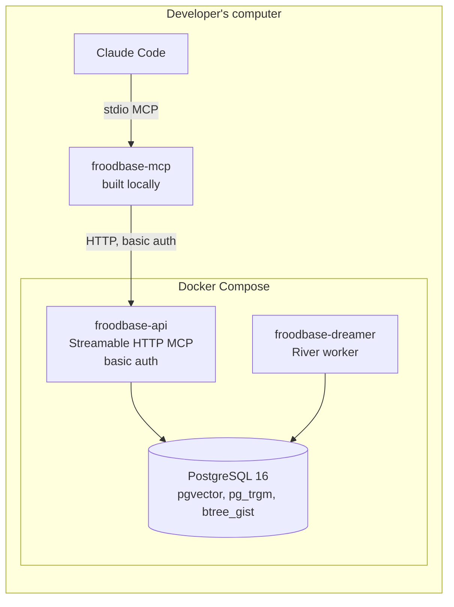
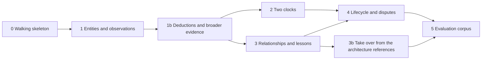

# Froodbase: local MVP

Status: approved scope (board decision, 14 October 2026). Narrows the [implementation plan](04-implementation-plan.md) to what is built first and where it runs. The [product requirements](01-product-requirements.md), [technical requirements](02-technical-requirements.md) and [architecture design](03-architecture-design.md) remain the reference; this document records what the MVP takes from them, what it replaces for local running, and what it defers.

Date: 14 October 2026. Revised 16 October 2026 to clarify source provenance and reviewer inspection, and again the same day for earned support, the smaller lifecycle and no report ingestion. Revised 20 October 2026 to add slice 1b (deductions and broader evidence) and slice 3b (taking over from the architecture references).

## 1. Purpose

Build the "brain" of Froodbase (knowledge model, two clocks, lifecycle and disputes, hybrid retrieval, dreamer jobs) and run it entirely on one computer, so its behaviour can be judged before any cloud infrastructure is paid for or operated. The MVP is additive to the implementation plan, not a replacement: when the exit gate in section 7 passes, the deferred work in section 8 moves the same code to Azure.

The brain is a shared memory for people and agents, not only a store of verified facts. An agent records what it observes and what it deduces; a deduction is a first-class record, labelled as an inference, linked to what it was deduced from and carrying the support that evidence and use earn it. The rules exist so that a deduction can be traced and weighed, not so that it must be proven before it is shared. The MVP also has to be able to take over from the Markdown architecture references the investigation agents read today, which brings the phase 3 importer and the phase 6 knowledge views forward (slice 3b).

Gate 0 of the implementation plan (build or buy) is taken as **build** by this decision. The organisational parts of phase 0 (named curators, pilot areas, operating ownership) are not needed to run locally and are picked up when the cloud move starts.

## 2. Runtime topology

| Part | MVP form | Cloud form it stands in for |
|---|---|---|
| `froodbase-mcp` | Built with `make build` and registered in Claude Code as a stdio server; credentials from environment variables | Signed release binary, Entra device-code sign-in |
| `froodbase-api` | Container in Compose, plain HTTP on localhost, HTTP basic auth checked against a static user list | Container Apps behind TLS, Entra bearer tokens |
| `froodbase-dreamer` | Container in Compose, one replica | Container Apps |
| PostgreSQL | Compose service with a local password, data in a named volume | Flexible Server, Entra-only auth, PITR |
| Migrations | goose, run by a `make` target against the Compose database | Run from the deployment pipeline |
| Secrets | `.env` file, ignored by git, documented in `docs/dev/ops/development.md` | Key Vault |
| Telemetry | Structured logs to stdout | OpenTelemetry to Log Analytics |

The three-binary split is kept exactly. `froodbase-mcp` never talks to PostgreSQL; `froodbase-api` is the only writer; everything asynchronous runs in `froodbase-dreamer`. This is what makes the cloud move a change of hosting rather than a rewrite.

## 3. Deviations from the architecture design

| Area | Design | MVP | Why it is safe to defer |
|---|---|---|---|
| Identity (TR-11, TR-70) | Entra OAuth 2.1, app roles, group mapping | Static users: username, bcrypt password hash, and (area, role) grants, loaded by `froodbase-api` at start | The authorisation context (`internal/authz`) is an interface with one implementation now and Entra as a second later; tool handlers, RLS and audit only see the context |
| Database auth (TR-03) | Managed identity, Entra-only | Password from the environment | Local only; the connection string is the only thing that changes |
| Hosting (TR-01, TR-04) | Container Apps, Terraform | Docker Compose | Containers are the same images |
| Migrations (TR-92) | Pipeline only | Developer runs `make migrate` locally | The cloud rule stands; the local target is the pipeline's stand-in |
| Vector channel (TR-51, TR-58) | Optional per area | Off; no model endpoint | The identifier, full-text and relationship channels do not need a model; the fusion code accepts a fourth channel when it arrives |
| Reflection (TR-80 to TR-84) | Budgeted dreamer job | Not built | Rule-based gap scan and reconsideration are built; they do not need a model |
| Redaction (TR-72) | Admin path with snapshot scrub | Not built | Operational; nothing in the MVP produces restricted excerpts that cannot be deleted by resetting the volume |
| Distribution | Signed binaries, install scripts, version handshake with update message | `make build`; the version handshake is built, the update message is a log line | The handshake is cheap and proves the contract |

## 4. Product rules that still bind

The MVP is judged on these, not on feature count. From `docs/planning/01-product-requirements.md`:

- Validity is never inferred from recording time (PR-21, TR-32).
- A null end date means "not known to have ended", not "verified current" (PR-22, TR-31).
- Contradictions become disputes; conflict detection never automatically ends validity or retires an existing record (PR-31, D14).
- Everything is append-only with revisions (PR-32, TR-35).
- Concurrent writers are rejected on a stale base revision; retries with the same idempotency key do not duplicate (PR-44, PR-45).
- Permissions are enforced per human caller before retrieval, in the application and in row-level security (PR-62, TR-52, TR-71).
- Corroboration counts distinct evidence roots (PR-12, TR-25).
- Support, epistemic kind and lifecycle state remain separate. Support is earned from distinct roots, verifications and evidenced outcomes, never from retrieval, repetition or model confidence; there is no proposed or accepted state and an inference stays an inference (PR-15, PR-40, PR-42, TR-29, TR-43).
- Reports, conversations and transcripts are never an input; `froodbase-mcp` reads no local documents (PR-50, TR-62).
- Every result carries lifecycle state, epistemic kind, support, scope, validity, verification date and citations (TR-14).

## 5. Slices

Each slice is a workstream on the board. Every slice advances all three binaries together, so after each one the Compose stack and Claude show something new end to end, and each slice carries its own integration tests on a disposable database. The domain package (`internal/domain`) grows a slice at a time, with table-driven tests landing before the store code that uses them.

### Slice 0: walking skeleton

| Binary | Delivers |
|---|---|
| `froodbase-api` | Compose stack; goose migrations with a first versioned migration; static-user basic auth producing an authorisation context; a `whoami` tool returning the caller's identity and grants; health endpoint |
| `froodbase-mcp` | Stdio MCP server registered in Claude Code; forwards `whoami`; returns the explicit "Froodbase unavailable" result when the API is down; version handshake |
| `froodbase-dreamer` | River client against the Compose database; a periodic heartbeat job; health endpoint |

Exit: `make up` starts the stack from a clean checkout; Claude calls `whoami` through `froodbase-mcp` and sees its user and grants; stopping the API makes the same call return the unavailable result; the dreamer heartbeat is visible in its logs and in the River job table.

### Slice 1: entities and observations

| Binary | Delivers |
|---|---|
| `froodbase-api` | Schema for knowledge areas, entities, entity names, observation assertions, evidence with roots and versioned references to living sources, claim evidence, support event history, contributions and contribution claims, revisions, audit events; row-level security on the caller's areas; `contribute` for entities, observations and evidence (active, one `root_added` per distinct root, idempotency key); `get_record`; `get_history`; `search` with the identifier and full-text channels |
| `froodbase-mcp` | The same tools |
| `froodbase-dreamer` | Full-text and trigram index maintenance job enqueued in the write transaction (the outbox pattern, D5) |

Exit: from Claude, contribute an entity with an observation and shareable evidence, search for it by name and by a word in its body, read its history; a user without the area sees nothing and an audit event records the denied read; the index job runs within seconds of the write.

### Slice 1b: deductions and broader evidence

Added after slice 1, when using it showed a strict fact store rather than a shared memory: an agent could not record a deduction, only facts with web citations were accepted, and a person had to supply every field.

| Binary | Delivers |
|---|---|
| `froodbase-api` | `contribute` accepts inferences and decisions as well as observations, each citing evidence, naming the records it was derived from, or both; derivation links stored with row-level security; a deduction inherits one root per distinct root of its sources. Evidence kinds for a fact observed by running a command against a resource (resource identity, the command with secrets removed, the time it ran) and for a statement by a named person (only the caller, weighted lower by the area's support configuration); the evidence rule becomes "checkable by the intended audience" (PR-11). Looser input: evidence kind inferred from well-known URLs, access class defaulted to the area, refs generated |
| `froodbase-mcp` | The same tools; a repository skill teaches Claude to turn a plain-language finding, a command it ran or a document it read into contributions, searching before creating, citing existing records, and listing back anything with nothing checkable behind it |
| `froodbase-dreamer` | Reconsideration job, strengthening half: when a record gains a new root, every deduction derived from it gains that root too |

Exit: in Claude, a person describes a finding in plain words and Claude contributes it without asking for fields; an agent records an observation from a ticket and one from an `az` command, then an inference derived from both, which is active, labelled inference, below the inference threshold and shown with its sources; a person adds a statement of their own; a new independent root on one observation strengthens the inference through the dreamer; Claude records the evidenced findings of a committed sample document, citing its sections; reading back shows every record's sources.

### Slice 2: two clocks

| Binary | Delivers |
|---|---|
| `froodbase-api` | The four temporal fields and "validity unknown" marking; structured scope with the shared overlap function in SQL; `search` modes `current`, `as_of` and `historical` as one SQL predicate; `get_as_of`; the `stale` flag |
| `froodbase-mcp` | Modes and as-of exposed on the tools |
| `froodbase-dreamer` | Review sweep marking records past `review_due_at` and stale `verified_at` |

Exit: the pitch's worked example (failure on 2.3, fix merged, 2.4 deployed and verified, older investigation imported later) is a named integration test and a Claude walkthrough; a current query never returns the superseded failure, an as-of query for the incident date does, and the late import does not reopen it.

### Slice 3: relationships and lessons

| Binary | Delivers |
|---|---|
| `froodbase-api` | Relationship types with endpoint rules and cardinality; relationships; lessons with their five sections; `list_relationships`; the relationship expansion channel; reciprocal rank fusion with k of 60 and the support and verification boosts, no recency boost |
| `froodbase-mcp` | The same tools |
| `froodbase-dreamer` | Rule-based gap scan (unowned entities, evidence-free relationships, lessons unverified in scope) feeding `list_due_for_review` |

Exit: "what depends on X" is answered from relationships without text matching; a lesson is retrieved by symptom; an entity created without an owner appears in the due-for-review list after the next scan.

### Slice 3b: take over from the architecture references

The investigation agents read Markdown references packaged with the toolkit (the system-map-discovery architecture references). Froodbase can replace them only when the same knowledge is imported with honest provenance and agents can read it back as readable pages.

| Binary | Delivers |
|---|---|
| `froodbase-api` | Importer for the architecture references at a pinned commit of the toolkit repository: entities, relationships, observations and deductions with file and section provenance, the documents' own observed, inferred and unverified labels mapped onto kind and support, nothing upgraded; a reconciliation report of overlapping records; `list_views` and `get_view` tools serving per-area pages filtered by permission |
| `froodbase-mcp` | The view tools |
| `froodbase-dreamer` | Knowledge-view build: a page per system with its relationships, observations and labelled deductions, every statement linking its records, rebuilt as deltas with a watermark and a stale marker |

Exit: the toolkit's architecture references are imported and their pages regenerated; a coverage report shows, file by file, what each page reproduces, what it holds with less certainty, and what could not be imported and why; no claim the originals mark as inferred or unverified appears as observed; an agent reads a system's page from Claude.

### Slice 4: lifecycle and disputes

| Binary | Delivers |
|---|---|
| `froodbase-api` | Lifecycle state machine (active, disputed, superseded, retracted) with role checks; `review_claim` (dispute, resolve, supersede, retract, verify, flag); `report_outcome`; an area-scoped way for reviewers to inspect every contribution and individual claim in any state; conflict classifier on write producing change-over-time, scope, correction or dispute outcomes; versioned area support configuration with per-kind thresholds; base-revision conflicts; `explain_answer`; the `insufficient_evidence` flag; pagination with cursors (derivation links arrive in slice 1b) |
| `froodbase-mcp` | The same tools |
| `froodbase-dreamer` | Reconsideration job (started in slice 1b) extended to the weakening events: supersession, retraction, contradiction and source change reach every dependant, and those below threshold are flagged `needs_reconsideration`; quiet-use credits in the review sweep |

Exit: two concurrent writers on one record, the second is rejected with the current revision; overlapping incompatible observations produce a dispute and both stay retrievable; a supersession removes the old record from current search immediately and lowers the support of its derived inference; an independent root and an evidenced successful outcome carry an inference across its threshold while a duplicate echo and a retrieval change nothing; a failed outcome lowers it; a reviewer can inspect and flag any claim without changing its state; `explain_answer` lists every candidate and the rule that kept or dropped it.

### Slice 5: evaluation corpus

| Binary | Delivers |
|---|---|
| `froodbase-api` | A seeded corpus covering every case in product requirements section 8, loaded into a disposable database, and a harness reporting the section 8 measures |
| `froodbase-mcp` | Unchanged |
| `froodbase-dreamer` | Unchanged; the harness runs its jobs synchronously |

Exit: one command runs the whole question set and reports labelling, citation, merge, abstention, propagation, concurrency and access results.

## 6. Stack additions

Added when a slice reaches them, with licences recorded in `docs/dev/ops/third-party.md` at that point: MCP Go SDK, pgx v5, sqlc, River, goose, Testcontainers for Go. The `.agents/facts/go.md` list is the source of truth.

## 7. MVP exit gate

The MVP is done when all slice exits hold and:

- The evaluation harness passes with no current-state answer citing a superseded record, no restricted record leaked, no lost update and no false merge across environment scope.
- A newcomer can start the stack and make their first contribution from Claude by following `docs/dev/ops/development.md` alone, describing the finding in plain words.
- Froodbase can take over from the system-map-discovery architecture references: the slice 3b coverage report shows the regenerated pages reproduce what the files said, with every difference explained, and an investigation agent can answer its usual architecture questions from Froodbase instead of the files.
- The authorisation context interface has no basic-auth type in its signature, so the Entra implementation is an addition.

Passing the gate reopens the implementation plan at phase 1 for the cloud move, with the brain already built.

## 8. Out of scope for the MVP

Deferred work is tracked as low-priority backlog tickets on the board, not here. In summary: Entra sign-in and Streamable HTTP OAuth, Terraform and Container Apps, the vector channel and embeddings, reflection and consolidation, redaction, signed binaries and install scripts, and importing knowledge beyond the system-map-discovery architecture references.
