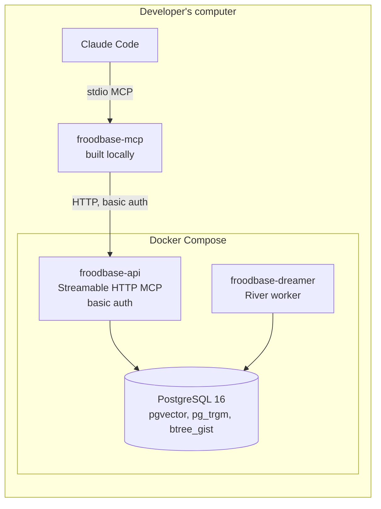
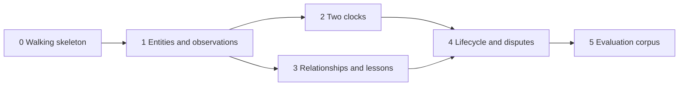

# Froodbase: local MVP

Status: approved scope (board decision, 14 October 2026). Narrows the [implementation plan](04-implementation-plan.md) to what is built first and where it runs. The [product requirements](01-product-requirements.md), [technical requirements](02-technical-requirements.md) and [architecture design](03-architecture-design.md) remain the reference; this document records what the MVP takes from them, what it replaces for local running, and what it defers.

Date: 14 October 2026. Revised 16 October 2026 to clarify source provenance and reviewer inspection.

## 1. Purpose

Build the "brain" of Froodbase (knowledge model, two clocks, lifecycle and disputes, hybrid retrieval, dreamer jobs) and run it entirely on one computer, so its behaviour can be judged before any cloud infrastructure is paid for or operated. The MVP is additive to the implementation plan, not a replacement: when the exit gate in section 7 passes, the deferred work in section 8 moves the same code to Azure.

Gate 0 of the implementation plan (build or buy) is taken as **build** by this decision. The organisational parts of phase 0 (named curators, pilot areas, operating ownership) are not needed to run locally and are picked up when the cloud move starts.

## 2. Runtime topology

| Part | MVP form | Cloud form it stands in for |
|---|---|---|
| `froodbase-mcp` | Built with `make build` and registered in Claude Code as a stdio server; credentials from environment variables | Signed release binary, Entra device-code sign-in |
| `froodbase-api` | Container in Compose, plain HTTP on localhost, HTTP basic auth checked against a static user list | Container Apps behind TLS, Entra bearer tokens |
| `froodbase-dreamer` | Container in Compose, one replica | Container Apps |
| PostgreSQL | Compose service with a local password, data in a named volume | Flexible Server, Entra-only auth, PITR |
| Migrations | goose, run by a `make` target against the Compose database | Run from the deployment pipeline |
| Secrets | `.env` file, ignored by git, documented in `docs/dev/ops/development.md` | Key Vault |
| Telemetry | Structured logs to stdout | OpenTelemetry to Log Analytics |

The three-binary split is kept exactly. `froodbase-mcp` never talks to PostgreSQL; `froodbase-api` is the only writer; everything asynchronous runs in `froodbase-dreamer`. This is what makes the cloud move a change of hosting rather than a rewrite.

## 3. Deviations from the architecture design

| Area | Design | MVP | Why it is safe to defer |
|---|---|---|---|
| Identity (TR-11, TR-70) | Entra OAuth 2.1, app roles, group mapping | Static users: username, bcrypt password hash, and (area, role) grants, loaded by `froodbase-api` at start | The authorisation context (`internal/authz`) is an interface with one implementation now and Entra as a second later; tool handlers, RLS and audit only see the context |
| Database auth (TR-03) | Managed identity, Entra-only | Password from the environment | Local only; the connection string is the only thing that changes |
| Hosting (TR-01, TR-04) | Container Apps, Terraform | Docker Compose | Containers are the same images |
| Migrations (TR-92) | Pipeline only | Developer runs `make migrate` locally | The cloud rule stands; the local target is the pipeline's stand-in |
| Vector channel (TR-51, TR-58) | Optional per area | Off; no model endpoint | The identifier, full-text and relationship channels do not need a model; the fusion code accepts a fourth channel when it arrives |
| Reflection (TR-80 to TR-84) | Budgeted dreamer job | Not built | Rule-based gap scan and reconsideration are built; they do not need a model |
| Report ingestion (TR-62, TR-63) | Preview in `froodbase-mcp`, commit through the API | Not built | A client feature; `propose_contribution` is the path it commits through and is built |
| Redaction (TR-72) | Admin path with snapshot scrub | Not built | Operational; nothing in the MVP produces restricted excerpts that cannot be deleted by resetting the volume |
| Distribution | Signed binaries, install scripts, version handshake with update message | `make build`; the version handshake is built, the update message is a log line | The handshake is cheap and proves the contract |

## 4. Product rules that still bind

The MVP is judged on these, not on feature count. From `docs/planning/01-product-requirements.md`:

- Validity is never inferred from recording time (PR-21, TR-32).
- A null end date means "not known to have ended", not "verified current" (PR-22, TR-31).
- Contradictions become disputes; nothing automatic sets `valid_to` or lifecycle state on an existing record (PR-31, D14).
- Everything is append-only with revisions (PR-32, TR-35).
- Concurrent writers are rejected on a stale base revision; retries with the same idempotency key do not duplicate (PR-44, PR-45).
- Permissions are enforced per human caller before retrieval, in the application and in row-level security (PR-62, TR-52, TR-71).
- Corroboration counts distinct evidence roots (PR-12, TR-25).
- Every result carries lifecycle state, epistemic kind, scope, validity, verification date and citations (TR-14).

## 5. Slices

Each slice is a workstream on the board. Every slice advances all three binaries together, so after each one the Compose stack and Claude show something new end to end, and each slice carries its own integration tests on a disposable database. The domain package (`internal/domain`) grows a slice at a time, with table-driven tests landing before the store code that uses them.

### Slice 0: walking skeleton

| Binary | Delivers |
|---|---|
| `froodbase-api` | Compose stack; goose migrations with a first versioned migration; static-user basic auth producing an authorisation context; a `whoami` tool returning the caller's identity and grants; health endpoint |
| `froodbase-mcp` | Stdio MCP server registered in Claude Code; forwards `whoami`; returns the explicit "Froodbase unavailable" result when the API is down; version handshake |
| `froodbase-dreamer` | River client against the Compose database; a periodic heartbeat job; health endpoint |

Exit: `make up` starts the stack from a clean checkout; Claude calls `whoami` through `froodbase-mcp` and sees its user and grants; stopping the API makes the same call return the unavailable result; the dreamer heartbeat is visible in its logs and in the River job table.

### Slice 1: entities and observations

| Binary | Delivers |
|---|---|
| `froodbase-api` | Schema for knowledge areas, entities, entity names, observation assertions, evidence with roots and versioned references to living sources, claim evidence, contributions and contribution claims, revisions, audit events; row-level security on the caller's areas; `propose_contribution` for entities, observations and evidence (proposed state, idempotency key); `get_record`; `get_history`; `search` with the identifier and full-text channels |
| `froodbase-mcp` | The same tools |
| `froodbase-dreamer` | Full-text and trigram index maintenance job enqueued in the write transaction (the outbox pattern, D5) |

Exit: from Claude, propose an entity with an observation and shareable evidence, search for it by name and by a word in its body, read its history; a user without the area sees nothing and an audit event records the denied read; the index job runs within seconds of the write.

### Slice 2: two clocks

| Binary | Delivers |
|---|---|
| `froodbase-api` | The four temporal fields and "validity unknown" marking; structured scope with the shared overlap function in SQL; `search` modes `current`, `as_of` and `historical` as one SQL predicate; `get_as_of`; the `stale` flag |
| `froodbase-mcp` | Modes and as-of exposed on the tools |
| `froodbase-dreamer` | Review sweep marking records past `review_due_at` and stale `verified_at` |

Exit: the pitch's worked example (failure on 2.3, fix merged, 2.4 deployed and verified, older investigation imported later) is a named integration test and a Claude walkthrough; a current query never returns the superseded failure, an as-of query for the incident date does, and the late import does not reopen it.

### Slice 3: relationships and lessons

| Binary | Delivers |
|---|---|
| `froodbase-api` | Relationship types with endpoint rules and cardinality; relationships; lessons with their five sections; `list_relationships`; the relationship expansion channel; reciprocal rank fusion with k of 60 and the verification and corroboration boosts, no recency boost |
| `froodbase-mcp` | The same tools |
| `froodbase-dreamer` | Rule-based gap scan (unowned entities, evidence-free relationships, lessons unverified in scope) feeding `list_due_for_review` |

Exit: "what depends on X" is answered from relationships without text matching; a lesson is retrieved by symptom; an entity created without an owner appears in the due-for-review list after the next scan.

### Slice 4: lifecycle and disputes

| Binary | Delivers |
|---|---|
| `froodbase-api` | Lifecycle state machine with role checks; `review_contribution` (accept, reject, dispute, supersede); `verify_record`; an area-scoped way for reviewers to inspect every contribution and individual claim, including accepted ones, and flag a claim for reconsideration; conflict classifier on write producing change-over-time, scope, correction or dispute outcomes; acceptance policy table defaulting to review; base-revision conflicts; derivation links; `explain_answer`; the `insufficient_evidence` flag; pagination with cursors |
| `froodbase-mcp` | The same tools |
| `froodbase-dreamer` | Reconsideration job walking derivation links and setting `needs_reconsideration` |

Exit: two concurrent writers on one record, the second is rejected with the current revision; overlapping incompatible observations produce a dispute and both stay retrievable; a supersession removes the old record from current search immediately and flags its derived inference for review; a reviewer can inspect and flag an accepted claim without silently changing its state; `explain_answer` lists every candidate and the rule that kept or dropped it.

### Slice 5: evaluation corpus

| Binary | Delivers |
|---|---|
| `froodbase-api` | A seeded corpus covering every case in product requirements section 8, loaded into a disposable database, and a harness reporting the section 8 measures |
| `froodbase-mcp` | Unchanged |
| `froodbase-dreamer` | Unchanged; the harness runs its jobs synchronously |

Exit: one command runs the whole question set and reports labelling, citation, merge, abstention, propagation, concurrency and access results.

## 6. Stack additions

Added when a slice reaches them, with licences recorded in `docs/dev/ops/third-party.md` at that point: MCP Go SDK, pgx v5, sqlc, River, goose, Testcontainers for Go. The `.agents/facts/go.md` list is the source of truth.

## 7. MVP exit gate

The MVP is done when all slice exits hold and:

- The evaluation harness passes with no current-state answer citing a superseded record, no restricted record leaked, no lost update and no false merge across environment scope.
- A newcomer can start the stack and make their first contribution from Claude by following `docs/dev/ops/development.md` alone.
- The authorisation context interface has no basic-auth type in its signature, so the Entra implementation is an addition.

Passing the gate reopens the implementation plan at phase 1 for the cloud move, with the brain already built.

## 8. Out of scope for the MVP

Deferred work is tracked as low-priority backlog tickets on the board, not here. In summary: Entra sign-in and Streamable HTTP OAuth, Terraform and Container Apps, the vector channel and embeddings, reflection and consolidation, knowledge views, report ingestion, redaction, signed binaries and install scripts, and the importer for the shipped architecture references.
